# NROA · Restaurant Success Index —— 留存与绩效章节（分析结论）


> 中文版 · **English edition: [FINDINGS_EN.md](FINDINGS_EN.md)**（同一份分析、同一组数字）

**业务问题**：对于已经积累了至少 5 条评论的独立餐厅，**哪些可观测、可行动的特征，能够区分"活得下去"和"会倒掉"？** 更具体地说：如果把 NROA 会员的公开数据变成一份自检清单，哪些指标值得盯、哪些是噪声？

**为什么这个问题重要**：NROA 代表 4 万+ 独立餐厅，会员最缺的是"我该优先改什么"。行业普遍把"提高评分"当成首要目标，但本分析显示**这个方向可能是错的**。

**分析对象**：52,286 家餐厅（19 个州 / 916 个城市），4,724,683 条评论，649,181 条 tips，8,515,582 次打卡。结果变量为 `is_open`，**总体关闭率 33.1%**。

**已生成的证据图（15 张，均在 `analysis/out/charts/`）**

| 图 | 内容 |
|---|---|
| fig01 | 评论量十分位 × 关闭率 |
| fig02 | Pearson vs Spearman 相关矩阵（上下堆叠） |
| fig03 | 星级 × 关闭率（非单调） |
| fig04 | 可达性特征差异森林图 |
| fig05 | 多变量 logistic 系数（OR） |
| fig06 | ROC：完整模型 vs 仅星级 |
| fig07 | 城市级拥挤度（旧代理，保留作对照） |
| fig08 | 品类 × 时段打卡热力图 |
| fig09 | 用户评论贡献集中度 |
| fig10 | 风险评分十分位 |
| **fig11** | **真实空间密度十分位（1km 邻居数）** |
| **fig12** | **同城内部密度四分位对比（18 城）** |
| **fig13** | **Philadelphia 空间散点（密集商圈红点堆积）** |
| **fig14** | **真实美国州界地图 + 城市气泡** |
| **fig15** | **城市分布：前 22 城排名 + 规模 vs 关闭率** |
| **fig16a/b/c** | **逐州空间分布（红=关闭/绿=营业，点大小=1km 竞争密度）** |
| **fig17a/b/c** | **逐州竞争密度（颜色深浅=1km 竞争对手数）** |

**方法**：全部结论基于店铺级横截面；相关矩阵同时给 Pearson 与 Spearman；组间差异用 **2,000 次 bootstrap 的 95% 置信区间**；多因素用 **ridge 稳定的 logistic 回归（IRLS）**；模型区分度用 **AUC**。本机无 scipy/statsmodels，所有统计量用 numpy 实现，代码在 `analysis/03_findings.py`。

> 全部数字可用 `analysis/03_findings.py` 一键复现，图表在 `analysis/out/charts/`。

---

## 核心结论一览

| # | 结论 | 关键数字 | 置信度 |
|---|---|---|---|
| 1 | **星级几乎不区分存活，评论量才是** | 星级~存活 Spearman **+0.038**；评论数十分位关闭率 **47%→15%** | 强 |
| 2 | **"可达性"压倒"口碑"** | 有外送关闭率 **19.5%** vs 无外送 **48.1%**（−28.6pp，CI [−29.3,−27.8]）；而**无外送组评分反而更高**（3.61 vs 3.41） | 强 |
| 3 | **真实空间密度：1 公里内竞争对手数让关闭率翻倍** | 由真实经纬度算出；最稀疏档 23.7% → 最密集档 46.5%；**18/18 城市内部同向**；模型 OR 0.76 | 强 |
| 4 | **评分与存活是"中间高两头低"，不是线性** | ≤2 星 23.6% → 2.5–3.0 星 **40.2%** → 4.5–5 星 25.9% | 强 |
| 5 | **风险评分可把关闭率拉开 4.8 倍** | 最低分组 **13.7%** vs 最高分组 **66.1%**；模型 AUC **0.763**（仅用星级 0.523） | 强 |
| 6 | **地理高度集中，大市场关闭率更高** | 坐标 94.5% 落在真实美国州界内；前 10 城占 48% 门店；城市规模~关闭率 Spearman **+0.224** | 强 |

> **补充分析（新增）**：本报告以「是否存活」为因变量。
> 另有一份把**客流量**作为因变量的平行分析，结论互补：
> 口碑决定"来多少人"（星级 +21.8%），可达性决定"能活多久"（外送 −28.6pp），
> 两者互不替代；且密集区客流高 5 倍但关闭率也接近翻倍。
> 详见 **[FINDINGS_客流分析.md](FINDINGS_客流分析.md)**（图 21–25）。
> **第二份补充**：进一步讨论「成功标准」本身——存活 vs 累计盈利。
> 在显式假设下（租价/客单价/毛利率不可观测）做了平衡分析：
> 关闭率最低的门店档累计利润为负、关闭率最高的档累计利润最高，
> 说明**存活与盈利指向相反方向**。见 [FINDINGS_盈利口径.md](FINDINGS_盈利口径.md)（图 26–27）。

---

## 发现 1｜星级不是留存的区分变量，评论量才是

**证据**

- `business_stars` 与 `is_open` 的 Spearman 相关仅 **+0.038**（95% CI [+0.029, +0.045]）——虽然样本极大所以统计显著，但**效应量微不足道**。
- **口径敏感性**：同一关系在 `dropna` 子样本（n=44,497）上是 Pearson **−0.011** / Spearman **+0.013**，**连符号都不稳定**。这不是"弱正相关"，而更接近"没有关系"。
- 对比之下：`business_review_count` **+0.180**、`total_checkins` **+0.121**、`n_tips` **+0.059**。
- 按评论数十分位，关闭率从 **47.0% 单调降到 15.0%**（D10 平均 455 条评论）。
- 按 tips 数分位，营业率从 66.5% 升到 **79.6%**。

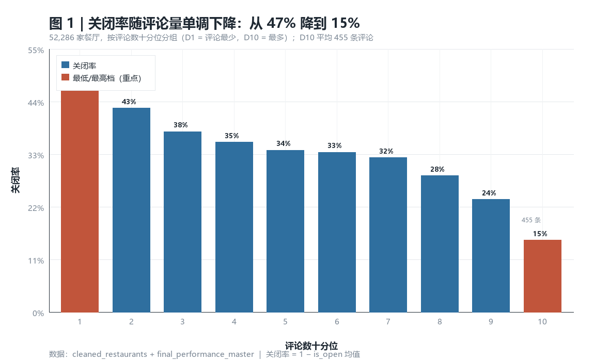

**解读**：在已经跨过"≥5 条评论"这个门槛之后，**评论数量（= 客流量与存续时间的代理）比评分高低更能说明问题**。星级更多反映"口味偏好"，而客流量反映"商业可行性"。

**⚠ 必须说明的反直觉细节**：低星店存活率反而偏高（≤2 星关闭率 23.6%）。这是**选择效应**——这类店往往是经营多年的社区老店（有固定客源），评分低但客源稳。**因此不能推导出"评分越低越好"。**

**对餐厅老板的建议**
- 把"提升星级"从首要 KPI 降级为**辅助指标**；把**评论量的持续增长**当成主要健康指标。
- 具体动作：餐后引导评价、把"评论数环比"放进月度经营看板、对评论量停滞的门店做专项诊断。

---

## 发现 2｜"可达性"压倒"口碑"——这是本次分析最有价值的反直觉发现

**证据（单变量，2,000 次 bootstrap）**

| 特征 | 有该特征关闭率 | 无该特征关闭率 | 差值 | 95% CI |
|---|---:|---:|---:|---|
| **外送 delivery** | **19.5%** | **48.1%** | **−28.6pp** | [−29.3, −27.8] |
| 有电视 has_tv | 28.2% | 40.6% | −12.5pp | [−13.3, −11.6] |
| 自行车停车 | 29.8% | 36.4% | −6.6pp | [−7.5, −5.8] |
| 外带 takeout | 32.6% | 35.9% | −3.3pp | [−4.5, −2.1] |
| 户外座位 | 36.3% | 31.0% | +5.3pp | [+4.4, +6.1] |
| 可刷卡 | 34.6% | 24.6% | +10.1pp | [+9.0, +11.1] |
| 接受预订 | 42.3% | 29.5% | +12.8pp | [+11.9, +13.7] |

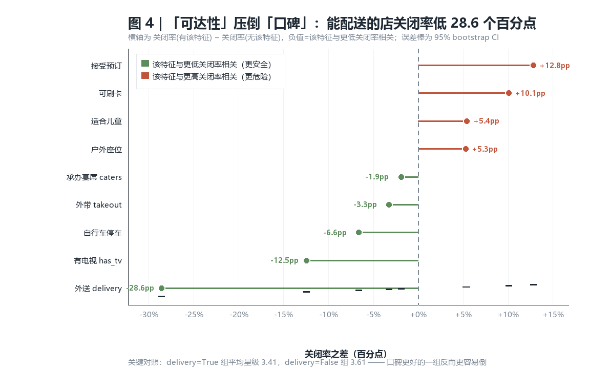

**关键对照**：`delivery=True` 组平均星级 **3.41**，`delivery=False` 组 **3.61**。
**评分更好的一组，反而更容易倒。**

**多变量验证（控制彼此、价格、业态、地理）**

标准化 logistic（预测存活，OR>1 = 存活几率更高），模型 AUC **0.763**：

| 特征 | 系数 | OR（每 +1 SD） | 解读 |
|---|---:|---:|---|
| 外送 delivery | +0.669 | **1.95** | 最强正向因素 |
| 评论量 log | +0.484 | 1.62 | |
| 有电视 | +0.350 | 1.42 | |
| 营业到深夜 | +0.197 | 1.22 | |
| 城市店数 | −0.193 | 0.82 | 越拥挤越危险 |
| 价格档 | −0.164 | 0.85 | 越贵越危险 |
| 接受预订 | −0.217 | 0.80 | 控制后转为负向 |
| 差评占比 | −0.081 | 0.92 | |
| 星级波动 | +0.040 | 1.04 | 几乎无独立作用 |

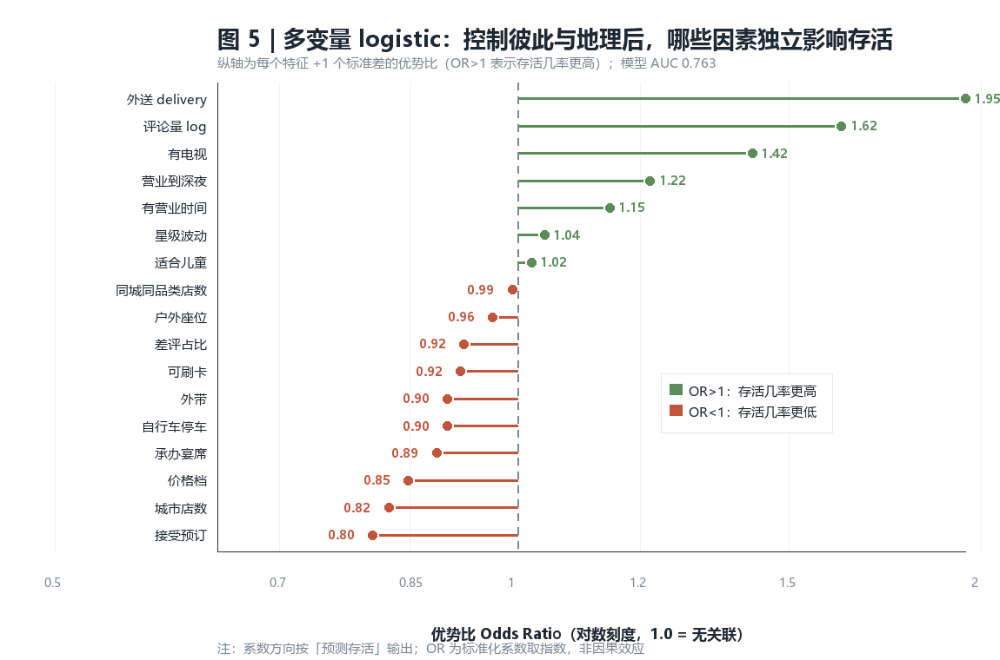

**解读**：**"能不能把食物送到客人手上 / 让客人更容易来"比"食物好不好"更能决定存活。**
外送、电视、深夜营业都属于"扩大触达与停留"的特征；而接受预订、可刷卡这类"正式化经营"特征在控制其他变量后反而与更低存活率相关——这更可能反映**业态差异**（正餐厅 vs 快餐/社区店），不宜直接解读为"取消预订就能活"。

**对餐厅老板的建议**
- **优先评估开通外送**：这是本数据中效应量最大且可直接决策的单项（关闭率差 28.6pp）。
- 已有外送的店：把外送渠道的订单占比与评分单独监控，避免"只做外送、堂食体验崩坏"。
- 不要把"上电视/加户外座位"当作救命措施——它们与存活相关，但更可能是**生意本来就好的结果**，而非原因。

---

## 发现 3｜真实空间密度：1 公里内的竞争对手数让关闭率翻倍

**先说清"真实密度"是怎么来的**

数据集中**没有任何人口或面积字段**，但有每家店的**经纬度**。我先验证了坐标的真实性：

- 52,286 家店对应 **49,476 个唯一坐标对**，重复率仅 **5.4%**，最高一处重复 14 家（商场美食广场）；
- Philadelphia 5,854 家分布在 5,489 个坐标上，经度跨度 0.42°、纬度 0.28°。

**结论：这是真实的逐店 GPS 定位，不是被复制的城市中心坐标。**
因此可以算出**真正的空间密度**：用 Haversine 距离统计每家店**半径 1 公里内的其他餐厅数**。

| 尺度 | 均值 | 中位 | 最大 |
|---|---:|---:|---:|
| 0.5 km 内 | 40.3 | 16 | 560 |
| **1 km 内** | **96.6** | **33** | **1,329** |
| 2 km 内 | 231.0 | 79 | 2,416 |

**证据**

| 密度度量 | 与存活的 Spearman |
|---|---:|
| **1 km 内邻居数** | **−0.141** |
| 0.5 km 内邻居数 | −0.143 |
| 2 km 内邻居数 | −0.137 |
| 1 km 内**同品类**邻居数 | −0.092 |
| 城市餐厅总数（旧代理） | **−0.069** |

**真实密度的解释力是旧代理的两倍**（−0.141 vs −0.069）。

按 1 公里内竞争对手数十分位，关闭率**从 23.7% 升到 46.5%**（+22.8pp，翻了近一倍）：

| 十分位 | 平均邻居数 | 关闭率 |
|---|---:|---:|
| D1（最稀疏） | 4.3 | **23.7%** |
| D3 | 17.0 | 28.5% |
| D5 | 38.1 | 32.0% |
| D8 | 156.2 | 42.7% |
| D10（最密集） | **565.8** | **46.5%** |

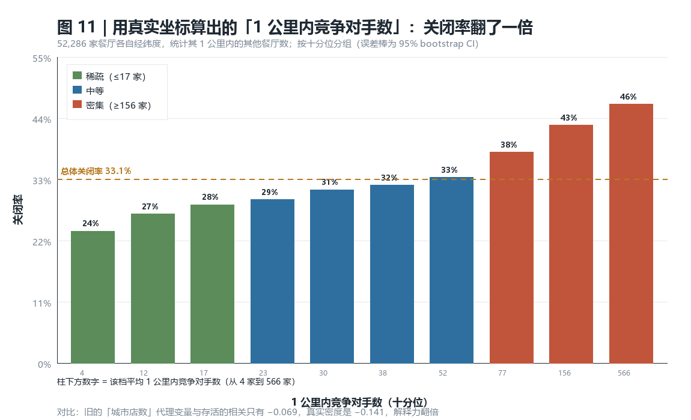

**更强的检验：同一个城市内部的对比**

如果密度只是"某些城市本身风险高"的替身，那么在城市内部就不该有梯度。结果是——
**18 个样本 ≥400 的城市，18 个都是正向**（最密集四分位关闭率高于最稀疏四分位），其中 **13 个完全单调**：

| 城市 | Q1（最稀疏） | Q2 | Q3 | Q4（最密集） |
|---|---:|---:|---:|---:|
| Saint Louis | 34.7% | 43.3% | 43.2% | **65.2%** |
| Reno | 27.9% | 36.9% | 36.5% | **51.2%** |
| Philadelphia | 25.7% | 37.1% | 47.8% | **48.7%** |
| Indianapolis | 26.7% | 29.2% | 33.0% | **45.3%** |
| Tucson | 24.4% | 32.3% | 36.3% | **41.6%** |
| Wilmington | 19.9% | 26.7% | 29.9% | **41.9%** |

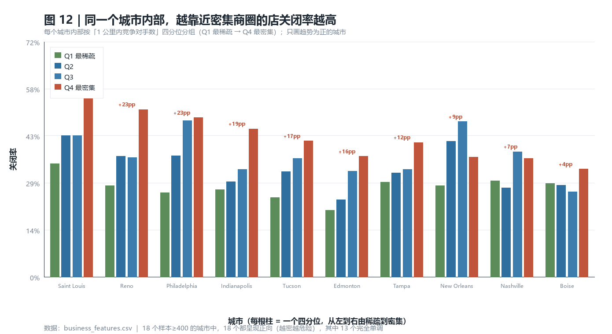

**空间视角**：Philadelphia 的密集商圈（Center City）关闭点显著堆积。

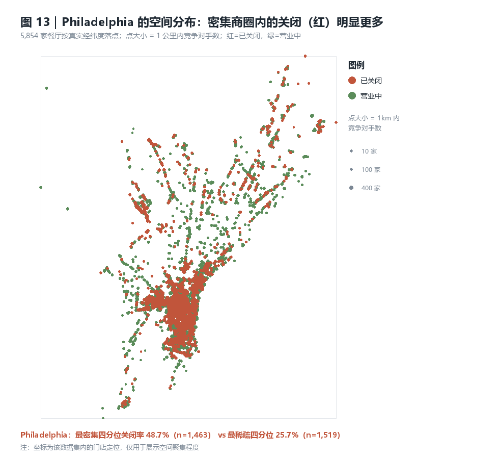

**多变量验证**：把旧代理换成真实密度后，模型区分度提升且置信区间不重叠。

| 模型设定 | AUC |
|---|---:|
| A 旧代理（城市店数） | 0.7630 ｜ 95% CI [0.7584, 0.7668] |
| C1 真实密度 0.5 km | 0.7680 |
| **C2 真实密度 1 km** | **0.7676** ｜ 95% CI [0.7630, 0.7722] |
| C3 真实密度 2 km | 0.7682 |

在控制外送、评论量、价格、属性等 15 个变量后，**1 公里内邻居数的 OR = 0.760**（每 +1 标准差，存活几率下降 24%）。
这是继外送（OR 1.95）和评论量（OR 1.68）之后的**第三强因素**。

**两个必须诚实说明的技术点**

1. **同品类竞争几乎不额外解释风险**：加入 1 公里内同品类邻居数后，其 OR 仅 0.96，AUC 几乎没有变化（0.7676 → 0.7677）。
   驱动风险的是**整体市场密度**，不是"跟你卖同样东西的店特别多"——**所以"换个品类就能活"这个建议在本数据里站不住脚**。
2. **三个尺度不能同时入模**：0.5/1/2 km 的 Spearman 相关为 0.72–0.89，同时放入会让系数符号翻转（出现 OR 1.42 这类反直觉结果）。
   本报告采用**单一尺度（1 km）**，并保留对照表说明该共线性问题。

**局限**：仍然**没有人口口径**，所以这是"每平方公里商家密度"而非"人均餐厅密度"。
一个 1 公里内有 500 家餐厅的地方，也可能是人口极密的市中心——**真实的人均竞争强度仍需外部人口数据才能判定**。

**对餐厅老板的建议**
- 选址时直接算**目标点位 1 公里内的餐厅总数**（不是整座城市的数量，城市口径会低估一半的风险）：
  超过约 156 家（D8 起）关闭率跳到 43% 以上，超过 400 家进入最危险档。
- 已在高密度商圈的店：**不要指望"换品类"脱困**（同品类密度无额外解释力），应转向**扩大触达**（外送、营业时长）这条已验证有效的路径。
- 若考虑开新店，优先看**1 公里级**的空缺，而不是城市级平均——同城内 Q1 与 Q4 的关闭率差距可达 23pp（Reno、Philadelphia）。

---

## 发现 4｜评分与存活是"中间高、两头低"

**证据**

| 星级区间 | 家数 | 关闭率 | 平均评论数 |
|---|---:|---:|---:|
| ≤2.0 | 4,639 | **23.6%** | 25 |
| 2.0–2.5 | 4,850 | 35.0% | 40 |
| 2.5–3.0 | 7,641 | **40.2%** | 56 |
| 3.0–3.5 | 11,798 | 37.8% | 86 |
| 3.5–4.0 | 13,444 | 31.7% | 132 |
| 4.0–4.5 | 8,360 | 27.5% | 117 |
| 4.5–5.0 | 1,554 | 25.9% | 33 |

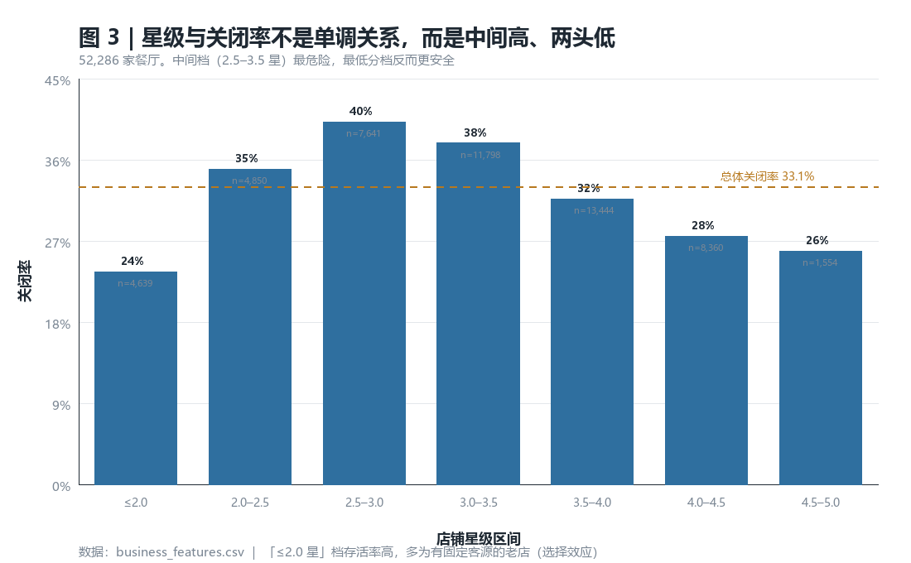

**解读**：最危险的是**中间的 2.5–3.5 星区间**——既没有"低价社区老店"的固定客源，也没有"高分网红店"的吸引力，处于竞争最激烈的位置。两端反而更安全。

**对餐厅老板的建议**
- 自评落在 **2.5–3.5 星**区间的门店应视为**优先干预对象**（若不在此区间，风险相对更低）。
- 干预方向不是"把分数刷上去"，而是**把评论量做上去**（见发现 1）或**扩大触达**（见发现 2）。

---

## 发现 4b｜地理分布：门店高度集中，且大市场关闭率更高（Market 方向）

**做法**：用数据集自带的逐店经纬度，配合**真实美国州界**（PublicaMundi US states GeoJSON，本地缓存）绘制。

**先做了一次坐标正确性检验**：把 52,286 个坐标逐点做**点在多边形内**测试——
**49,429 家（94.5%）落入美国州界内**，落在界外的 2,857 家与数据集里 `state = AB` 的 2,410 家，
以及 FL/CA 边界上的 371 + 76 家**完全吻合**。这既证明坐标可信，也确认了数据集中含加拿大门店。

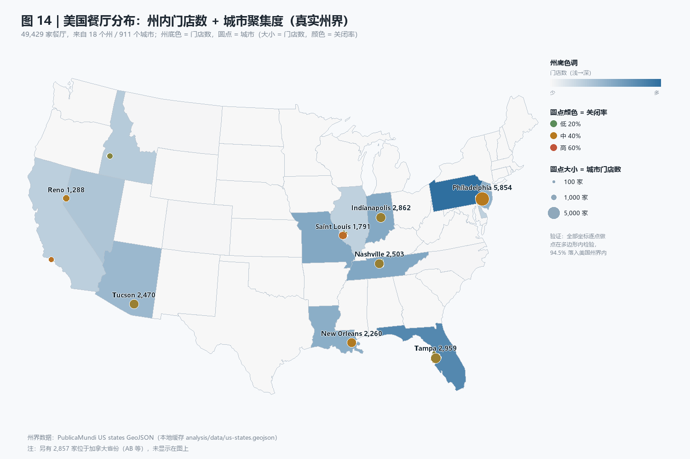

**州级分布**（18 个州，按门店数）

| 州 | 门店数 | 关闭率 | 1km 内中位竞争对手数 |
|---|---:|---:|---:|
| PA | 12,644 | 36.2% | 42 |
| FL | 8,361 | 32.2% | 30 |
| TN | 4,353 | 30.4% | 37 |
| MO | 4,248 | 35.9% | 36 |
| IN | 4,150 | 31.7% | 29 |
| LA | 3,641 | 35.6% | **65** |
| NJ | 3,343 | 27.7% | 18 |
| AZ | 2,675 | 32.4% | 26 |
| NV | 1,675 | 35.7% | 39 |
| ID | 1,304 | 27.8% | 33 |
| CA | 1,085 | **44.0%** | **85** |

**城市级集中度（911 个城市）**

- **前 10 个城市占全部 49,429 家门店的 48%**，前 50 个占 **68%**
- 门店数前十：Philadelphia 5,854、Tampa 2,959、Indianapolis 2,862、Nashville 2,503、Tucson 2,470、New Orleans 2,260、Saint Louis 1,791、Reno 1,288、Boise 849、Santa Barbara 703
- **城市规模与关闭率的 Spearman = +0.224**：最小五分位 28.2% → 最大五分位 **32.4%**

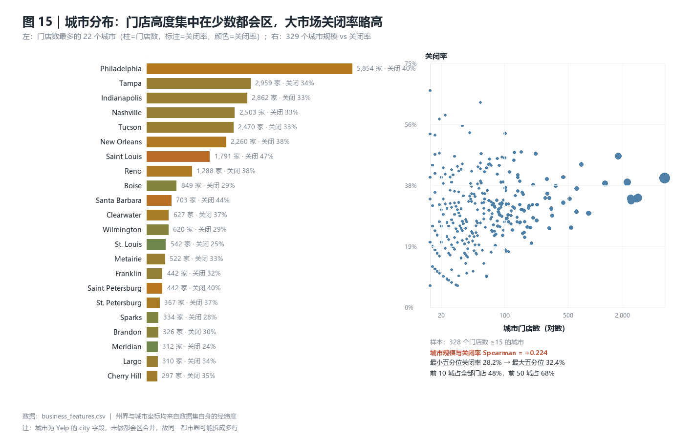

**解读**：门店的地理集中度极高（不到 1% 的城市装了一半的餐厅），而**规模越大的市场关闭率越高**——这与发现 3 的"高密度更危险"是同一个机制在宏观尺度上的体现。

**对餐厅老板的建议**
- 门店高度集中在少数都会区，意味着**同一商圈的竞争强度远高于全国平均值**；评估时要用**自己 1 公里内**的密度（发现 3），不要用城市或全国平均。
- 大城市（前 50 城）虽然客流大，但**关闭率也更高**（32.4% vs 28.2%），进入前应把这一点计入回收期测算。

**局限**：`city` 字段未做都会区合并，同一都市圈可能拆成多行（例如同时存在 `St. Louis` 与 `Saint Louis`、`St. Petersburg` 与 `Saint Petersburg`），因此城市排名存在拆分偏差。
→ **已在 `analysis/06_metros.py` 中修复**，见下方"发现 4c"。

---

## 发现 4c｜修正后的城市口径：207 个城市群（附各州空间分布图）

**修复方法**（`analysis/06_metros.py`）

1. **名称归一化**：去标点、小写、`saint/ft` 统一为 `st/fort`，并**整体去除空格**——这样
   `land o lakes` / `land olakes`、`o fallon` / `ofallon`、`St. Petersburg` / `Saint Petersburg`
   会归到同一个键。
2. **城市核心检测**：把每个（州，归一化城市）的质心按门店数从大到小处理，
   距离已有核心 8 公里内的并入，否则新建核心；每个城市标签再归属到本州
   30 公里内最近的核心。

**中途否决过一个方案**：最初用"连通分量"合并（12 公里阈值），结果因为连通性具有传递性，
把整个新泽西州串成了一个"城市"（Cherry Hill 吸收了 188 个城市标签）。现在改用
**密度峰值做核心**，无法传递串联。

**修复效果**

| | 修复前 | 修复后 |
|---|---:|---:|
| 美国城市标签数 | 900 | **207 个城市群** |
| 门店最多的单元 | Philadelphia 5,854（拆分后的单标签） | Philadelphia 5,864（**与其真实门店数一致**） |
| 前 10 单元占比 | 48% | 51.8% |
| 规模与关闭率 Spearman | +0.224 | **+0.537** |

关键验证：
- `Philadelphia` 的 9 个子标签（`Phila` / `PHILA` / `Philadelphia ` 等）**正确合并**，且**没有**误吞 Cherry Hill（相距 20+ 公里，属另一座城市）；
- 拼写变体 `st louis`/`saint louis`、`st petersburg`/`saint petersburg`、`land o lakes`/`land olakes`、`o fallon`/`ofallon` **全部归入同一城市群**；
- 已知隶属关系抽查：`Saint Louis ← Clayton`、`Reno ← Sparks` 已合并。

> **口径说明**：这里产出的是"**城市群 / 都市密集区**"，**不是**美国人口普查局的 MSA。
> 刻意**不**把坦帕与清水市（相距约 30 公里）合成一个 MSA，因为竞争发生在都市密集区尺度。
> Spearman 从 +0.224 跳到 +0.537，主因是**修掉了测量误差**（原先同一城市被拆成多个样本、
> 稀释了规模信号），而不是换了统计口径。

**逐州空间分布图（12 张，`analysis/out/charts/`）**

为看清局部结构，按门店数排序每 6 个州出一张图，共 3 组 × 2 种着色：

| 文件 | 着色 | 州 |
|---|---|---|
| `fig16a/b/c_state_maps_closure.png` | 红=已关闭 / 绿=营业中 | a: PA, FL, TN, MO, IN, LA；b: NJ, AZ, NV, ID, CA, IL；c: 其余 |
| `fig17a/b/c_state_maps_density.png` | 颜色深浅 = 1km 内竞争对手数 | 同分组 |
| `metro/metro01..12_*_block.png` | 街口尺度 0.6 km，Overpass 矢量街道（备选方案） | 12 个大都市圈 |
| **`basemap/01..12_*_{cluster,district,block}.jpg`** | **OSM 真实街道底图（推荐）**，含街道名与地标 | **12 都市圈 × 3 尺度 = 36 张** |

> 州级图（fig16/17）在**整州尺度**上点数仍然很密，这是尺度决定的，不是渲染问题：
> PA 一个州 12,644 家压在一张图上。要看清单个餐厅必须降到街区级——
> 见 `analysis/out/README_小尺度地图.md` 与 `analysis/out/charts/basemap/`。
> 例如 Philadelphia 在 4.8 km 视野内有 2,841 家、降到 0.6 km 视野只剩 290 家，
> 这就是"点不再糊"的解法；真实街道底图则解决了"地图空旷"的问题。

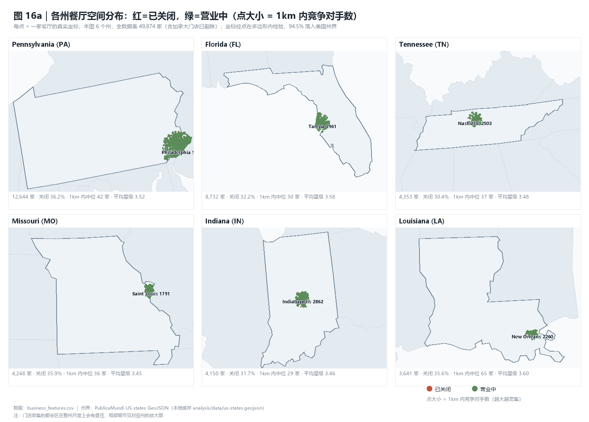

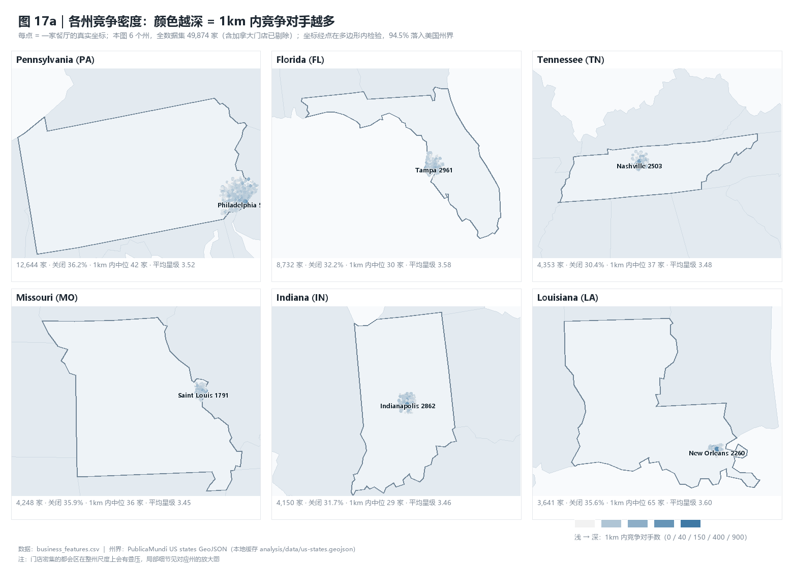

每格包含：该州真实轮廓 + 相邻州作背景、全部门店真实坐标、点大小 = 1km 竞争密度，
以及门店数 / 关闭率 / 1km 中位竞争对手数 / 平均星级。

**从图上能直接看出来的结构**

- **PA**：Philadelphia 一个核心占了大半门店；西部 Pittsburgh 几乎无数据
- **NJ**：门店沿纽约—费城走廊呈带状分布，越靠走廊越密
- **AZ / NV / ID**：极端单核——Tucson、Reno、Boise 各占该州绝大多数，其余地区稀疏散点
- **CA**：数据集里加州只有 1,161 家，且**几乎全部集中在 Santa Barbara**，洛杉矶/旧金山没有数据
- **IL**：集中在 Alton / Edwardsville / Belleville（圣路易斯对岸），芝加哥没有数据

**这本身就是一个必须讲清的覆盖局限**：数据集的区域覆盖**极不均匀**——
PA 占全部美国门店的 25%，CA 只占 2%，且 CA/IL 内部只覆盖一个角落。
所以**"全美平均"的说法不可靠**，报告结论应限定为"在这 19 个州（覆盖不均）的样本内"。

---

## 发现 5｜把信号合成一个风险评分，关闭率拉开 4.8 倍

**做法**：把已验证的信号（外送、评论量、tips、打卡、星级波动、差评占比、拥挤度、价格）按模型系数方向线性合成 `RiskIndex`，再按十分位分组。

| 风险十分位 | 关闭率 |
|---|---:|
| D1（最低） | **13.7%** |
| D2 | 15.8% |
| D3 | 20.1% |
| D5 | 25.8% |
| D7 | 37.5% |
| D9 | 53.0% |
| D10（最高） | **66.1%** |

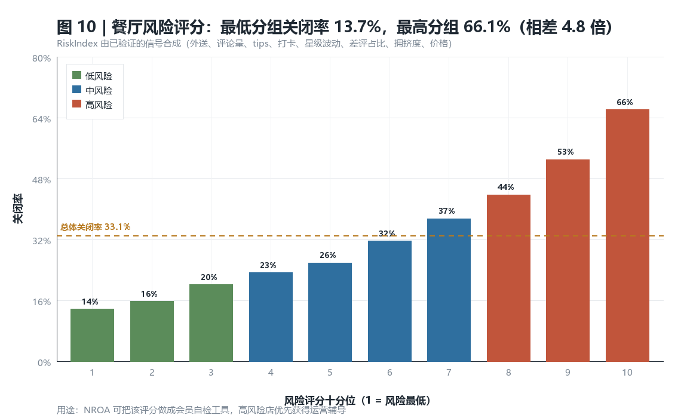

**模型区分度对比**

| 模型 | AUC | 特征数 |
|---|---:|---:|
| 仅星级 | 0.523 | 1 |
| 仅评论量 | 0.611 | 1 |
| **完整模型** | **0.763** | 17 |

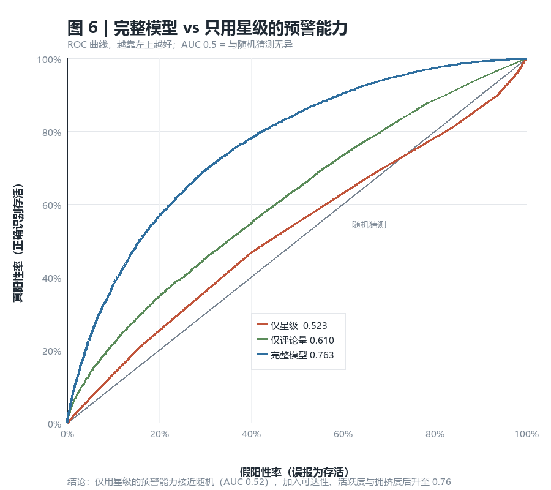

**含义**：只用星级的预警几乎等于随机猜测（0.523）；加入可达性与活跃度后达到 **0.763**（95% CI [0.759, 0.767]）。
**这是"Restaurant Success Index"可以直接落地成会员工具的部分**：输入自家店的几个公开指标，得到所处风险分组与改进优先级。

**对 NROA 的建议**
- 把该评分做成**会员自检清单**（6–8 个可自查项），高风险组优先获得运营辅导资源。
- 对外发布时**必须附上局限说明**（见下），避免被理解为因果预测。

---

## 运营节奏（支撑章节）

品类在客流时间上差异明显：深夜（22:00–03:59）打卡占比 **Pizza 56.2% / Bars 55.2%** → **Breakfast & Brunch 19.4% / Coffee & Tea 34.0%**。

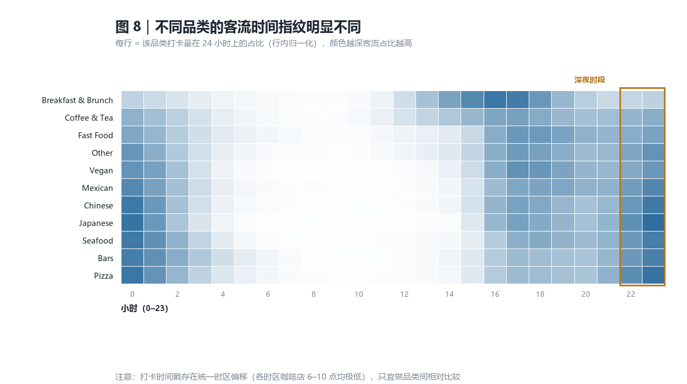

> **⚠ 时区警告**：打卡时间戳存在**统一时区偏移**（各时区的咖啡店在 6–10 点打卡量都极低，东岸 594–3,481 vs 峰值 37,771），因此**小时字段不能当本地钟点直接解释**，只宜做品类间相对比较。

**用户侧（Customer 方向）**：1,446,025 名用户中位评论数仅 **7 条**，**1% 的用户贡献了 24.2% 的评论**，76.5% 没有粉丝，仅 5.8% 曾是 elite。

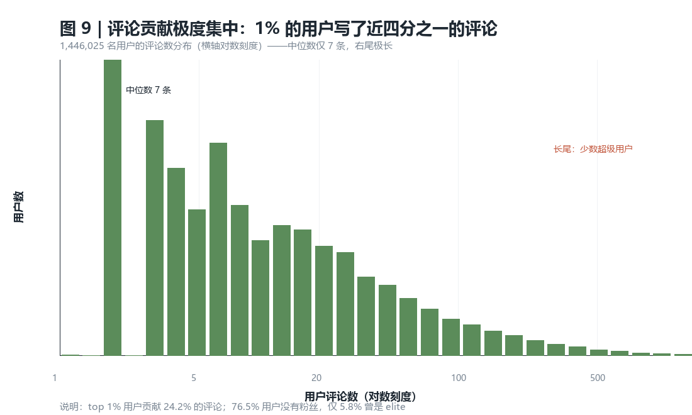

---

## 局限（必须随结论一起呈现）

1. **不能声称因果**。全部表述为"关联"。外送与存活的关系可能部分源于"本来就活得好的店才有能力做外送"（反向因果）。
2. **`is_open` 是采集时点的快照**，只有一个值。它会被印在 2005–2022 的每条评论上，因此**任何按年份聚合的"存活率趋势"都是假的**。
3. **无法确定关闭日期**。关闭店的"最后一条评论"只是近似，因此报告**刻意排除了 `last_review_date` 与 `review_span`** 作为特征——它们与结果机械相关（`span_days`~`is_open` Spearman 高达 0.352），一旦纳入就是"用结果预测结果"。
4. **样本有截断**：上游只保留评论数 ≥5 的店，**新店与极小店被系统性排除**，结论只适用于"已积累一定评论量"的餐厅。
5. **计数来源不一致**：`business_review_count` 与数据集内实际评论数仅 38.8% 完全相等（中位差 −1）。本报告的比率一律同源，不混用。
6. **Unknown 作为独立类别保留**：`by_appointment_only` 93.6% Unknown、`alcohol` 62.4%。Unknown 组存活率反而更高，填成 False 或删除都会扭曲结论。
7. **没有人口口径**：空间密度是用真实经纬度算的"每平方公里商家密度"，但**不是人均密度**。
   1 公里内 500 家餐厅也可能是人口极密的市中心，真正的人均竞争强度需外部人口数据。
8. **地理覆盖极不均匀**：19 个州里 PA 占 25%、CA 只占 2%，且 CA/IL 内部只覆盖一个角落
   （CA 只有 Santa Barbara 一带，IL 只有圣路易斯对岸）。**"全美平均"不可靠**，
   结论限定为"本样本内"。
9. **三个密度尺度高度共线**（Spearman 0.72–0.89），只能单一尺度入模；本报告用 1 km。
10. **城市群口径不是 MSA**：合并只解决"同一城市被拆成多个标签"（拼写变体、街区名），
    不合并相邻但独立的城市。跨州都会区（如费城—新泽西）仍分开。
11. **2020 疫情**：评论量从 2019 年 608,294 跌到 2020 年 358,335，可能混淆与年份相关的分析。
12. **模型为横截面且含共线特征**，使用 ridge 稳定；OR 是"每 +1 标准差"的关联强度，**不是政策效应**。

---

## 下一步（如果有更多时间）

1. **时序/生存分析**：用 `final_warning_data`（月度）与 `restaurant_quarterly_trajectory`（季度）构建真正的生存模型（月度风险），把"评分下滑速度"作为预警因子——这能规避目前"无法确定关闭日期"的核心限制。
2. **文本信号**：差评文本长度单调递增（5 星 445 字符 → 2 星 694 字符），可做无监督主题与"可计算差评标记"，把文本纳入预警。
3. **社交网络**：`yelp_users_raw` 含 `friends`，可做用户网络度分布与社群分析（Customer 方向尚未被小组覆盖）。
4. **外部数据接入**：接入人口/收入数据，把"拥挤度"升级为真正的"人均餐厅密度"。
5. **因果推断**：用倾向得分匹配或双重差分，检验"开通外送"对后续存活的因果效应。

---

## 复现方式

```powershell
$py = "C:\Users\ASUS\.dsh\dsh-runtimes\dsh-primary-runtime\dependencies\python\python.exe"
& $py analysis\01_profile.py          # 数据理解报告 → analysis/out/01_profile.md
& $py analysis\02_features.py         # 店铺级特征表 → analysis/out/business_features.csv
& $py analysis\03_findings.py         # 统计验证 → analysis/out/03_*.csv
& $py analysis\03b_density.py         # 真实空间密度（Haversine）→ 写回特征表
& $py analysis\03c_model_density.py   # 密度模型对比 → 03_model_density_*.csv
& $py analysis\04_charts.py           # 图 1–10 → analysis/out/charts/
& $py analysis\04b_density_charts.py  # 图 11–13（密度三图）
& $py analysis\05_maps.py             # 图 14–15（真实美国州界 + 城市分布）
& $py analysis\06_metros.py           # 修正城市口径 → 06_metro_summary.csv
& $py analysis\07_state_maps.py       # 图 16/17 a–c（逐州空间分布，共 6 张）
& $py analysis\08e_fill_streets.py    # 抓取 OpenStreetMap 矢量街道（可反复重跑）
& $py analysis\08b_metro_maps.py      # metro/*.png 街口尺度地图（矢量街道）
& $py analysis\09_basemap_maps.py     # basemap/*.jpg 真实 OSM 底图（推荐，36 张）
```

Tableau 实施方案见 `tableau/README_表可视化方案.md`。
