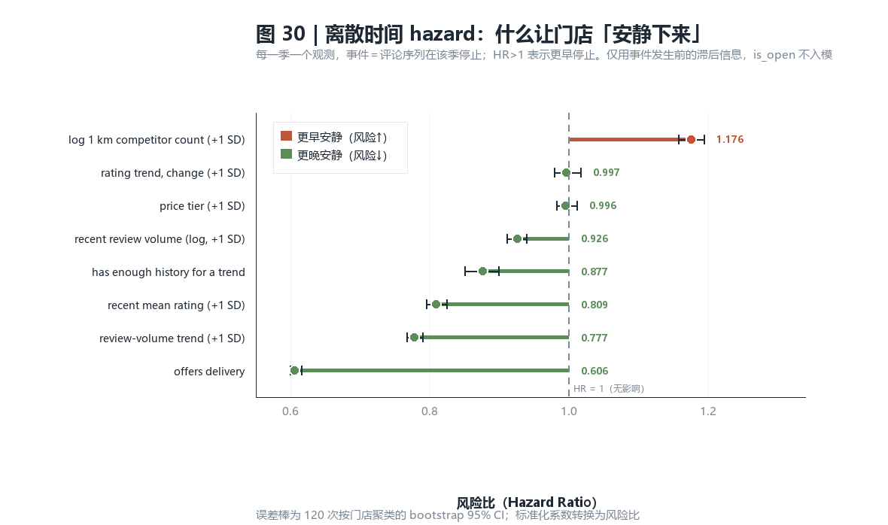
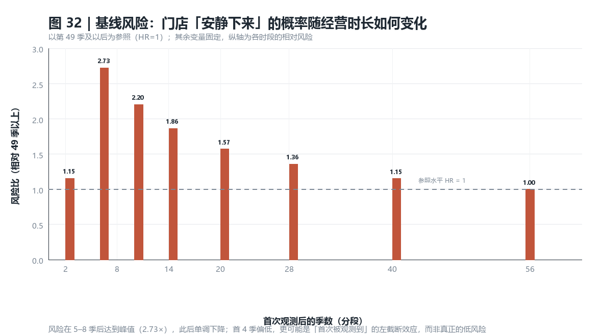

# 离散时间 hazard 模型：门店何时「安静下来」

> **English edition:** [FINDINGS_HAZARD_EN.md](FINDINGS_HAZARD_EN.md)（同一份分析、同一组数字）

**为什么补这一块**：主分析用 `is_open` 快照，只能区分「还开着」与「已关闭」，
**无法区分活了 3 年与活了 15 年**。季度轨迹表提供了每家店的观测序列，
使真正的「时间到事件」设计成为可能。

**结论摘要**：**评分下滑并不预测门店消失**（HR 0.997，CI [0.980, 1.017]）。
真正有预测力的是**评分水平**（HR 0.809）、**评论量趋势**（HR 0.777）
与**是否提供外送**（HR 0.606）。这是一条**被自己数据证伪**的假设。

---

## 1. 先修掉第 7 个数据陷阱：`final_warning_data` 不是「店铺×月」

两张表里只有一张能用：

| 表 | 行数 | 唯一(店,期) | 重复 | 能否用 |
|---|---:|---:|---:|---|
| `final_warning_data` | 4,724,683 | 1,825,219 | **2,899,464** | ❌ |
| `restaurant_quarterly_trajectory` | 986,088 | 986,088 | **0** | ✅ |

`final_warning_data` 的「重复行」**不是完全复制**——同一店同一月的
`rolling_avg_stars` 会给出 4.5 与 4.8 两个值。说明它实际是**评论事件粒度**
（每条评论一行，携带该月的滚动统计），却被标成「店铺×月」。
按店铺×月直接聚合会重复加权，因此本分析不使用它。

## 2. 模型设定

**离散时间 hazard**：把每人-期一行做 pooled logistic，
事件只在该店序列停止的那一季取 1，则拟合出的概率就是条件风险 $h(t\mid x)$。
基线风险用**期数分段哑变量**进入，不施加参数形状。

| 要素 | 设定 |
|---|---|
| 分析单元 | 门店 × 观测到的季度 |
| 观测期数 | 中位 15 季，最长 68 季 |
| 事件定义 | **评论序列在该季停止**（"安静下来"） |
| 事件数 | **17,235**（占门店 33.0%，与整体关闭率 33.05% 一致） |
| 删失 | 快照时仍营业（35,051 家），右删失 |
| 时间轴 | 首次观测后的季数（按观测次序，容忍中间缺口） |

### 与 `is_open` 的关系：只做验证，不入模

事件的**可观测定义**来自评论序列本身，而 `is_open` 与"序列何时停止"机械相关
（关闭店的序列必然更早停止）。若把 `is_open` 当预测变量，就是用结果预测结果——
这与主分析剔除 `last_review_date` 是同一条纪律。

因此：

- 全部预测变量只用**严格早于当前期**的信息（滞后 1 期、滚动 4 期、前 4 期对比）
- 刻意剔除 `business_stars`、`n_reviews`：它们由**全部历史**（含未来）算出
- `is_open` 只在最后用来做**外部校验**

## 3. 结果

| 变量（+1 标准差） | 风险比 HR | 95% CI | 显著 |
|---|---:|---|---|
| **提供外送** | **0.606** | [0.599, 0.615] | ✅ |
| 评论量趋势（近 4 季 vs 前 4 季） | 0.777 | [0.767, 0.790] | ✅ |
| 近期平均评分 | 0.809 | [0.795, 0.824] | ✅ |
| 有足够历史可算趋势 | 0.877 | [0.851, 0.899] | ✅ |
| 近期评论量（对数） | 0.926 | [0.911, 0.939] | ✅ |
| 价格档 | 0.996 | [0.983, 1.011] | ❌ |
| **评分趋势（变化量）** | **0.997** | **[0.980, 1.017]** | ❌ |
| 1 km 竞争对手数（对数） | **1.176** | [1.158, 1.194] | ✅ |

### 核心发现：评分趋势没有预警价值

**这是本次分析唯一推翻自己假设的地方。**

主分析的「下一步」里写过：把"评分下滑速度"作为预警因子。现在测了，
**不成立**——`HR 0.997`，置信区间紧贴 1。

左panel三条曲线（评分上升／持平／下滑）**完全重合**，
第 8 季与第 24 季的比例一模一样（87.7% / 68.7%）。
右panel的外送则明显分离（第 24 季 77.7% vs 47.2%，差 **30.5pp**）。

> **正确的解读**：影响门店存续的是**评分的绝对水平**，不是**评分的变化方向**。
> 「评分在跌」不是预警信号，「评分本来就低」才是。

### 两条与主分析互相印证的结论

| 本次（hazard） | 主分析（logistic / 描述） | 是否一致 |
|---|---|---|
| 外送 HR **0.606**（最强保护因素） | 有外送关闭率 19.5% vs 48.1%（−28.6pp） | ✅ 方向与量级都吻合 |
| 1 km 竞争对手 HR **1.176**（危险因素） | 密度十分位关闭率 23.7% → 46.5% | ✅ 一致 |

外送在**两种完全不同的建模方式**下都是最强的保护因素，这提高了该结论的可信度。

### 基线风险：不是「越新越危险」

风险在 **5–8 季**达到峰值（2.73×），此后单调下降到 49 季以上的 1.00。
首 4 季偏低（1.15×），更像是**左截断效应**——门店是因为拿到第一条评论
才进入观测，所以"刚被观测到"的时段并非真正的开业初期。

## 4. 模型表现与校验

| 指标 | 值 |
|---|---:|
| 人-期观测数 | 986,088 |
| 事件数 | 17,235 |
| 对数似然 | −82,617.2 |
| McFadden pseudo-R² | 0.0485 |
| 样本内 AUC | 0.6944 |
| **对 `is_open` 的 AUC（模型未见过的标签）** | **0.7045** |

pseudo-R² 0.0485 偏低，这在只使用**滞后的一阶/二阶时间信号**、
且不含门店身份特征的 hazard 模型里是正常的：大部分变异是个体异质性，
而不是可观测的轨迹。

外部校验 AUC **0.7045** 说明：即使完全不看 `is_open`，
仅凭评论序列本身的停止模式也能较好地还原"哪家店最终会关"。

## 5. 局限

1. **事件是「安静下来」，不是「关闭」**。两者高度相关但不是同一件事；
   一家店可能关店后仍有人补评论，或经营中长时间没人评论。
2. **没有真正的开业时间**。时间轴是「首次被观测到的季数」，
   因此早期基线风险受左截断影响（见 §3 末）。
3. **间隔不连续**。只观察到有评论的季度，中间空档被压缩掉；
   这让"季数"更接近"活跃季数"而非自然时间。
4. **静态属性是快照**。外送、价格档取自采集时点的店铺属性；
   对早期关闭的店，这些属性可能是关店后才记录的。
5. **仍未处理因果**。外送 HR 0.606 不能读作"开通外送能把风险降低 39%"，
   因为可能本来就是经营更好的店才有能力做外送。
6. **`is_open` 的时点未知**。事件季是序列停止季，而关闭可能发生在之后：
   这是**区间删失**，当前模型把它当作点事件处理。
7. **未做时间变化的宏观控制**。2020 疫情年的评论量骤降会推高该年的事件率；
   模型只用了期数分段，没有年份固定效应。

## 6. 产出

| 文件 | 内容 |
|---|---|
| `analysis/18_hazard.py` | 人-期数据构建（含粒度核查） |
| `analysis/19_hazard_model.py` | 离散时间 hazard 拟合 + 聚类 bootstrap |
| `analysis/21_hazard_curves.py` | 各维度的生存曲线重算 |
| `analysis/20_hazard_charts.py` | 图 30–32 |
| `08_hazard_person_period.csv.gz` | 986,088 行人-期数据 |
| `08_hazard_coefficients.csv` | 风险比与 95% CI |
| `08_hazard_curves.csv` | 各维度累计生存曲线 |
| `08_hazard_fit.md` | 拟合与校验指标 |
