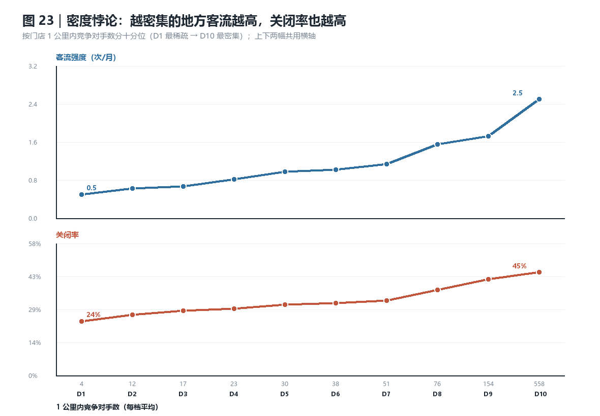
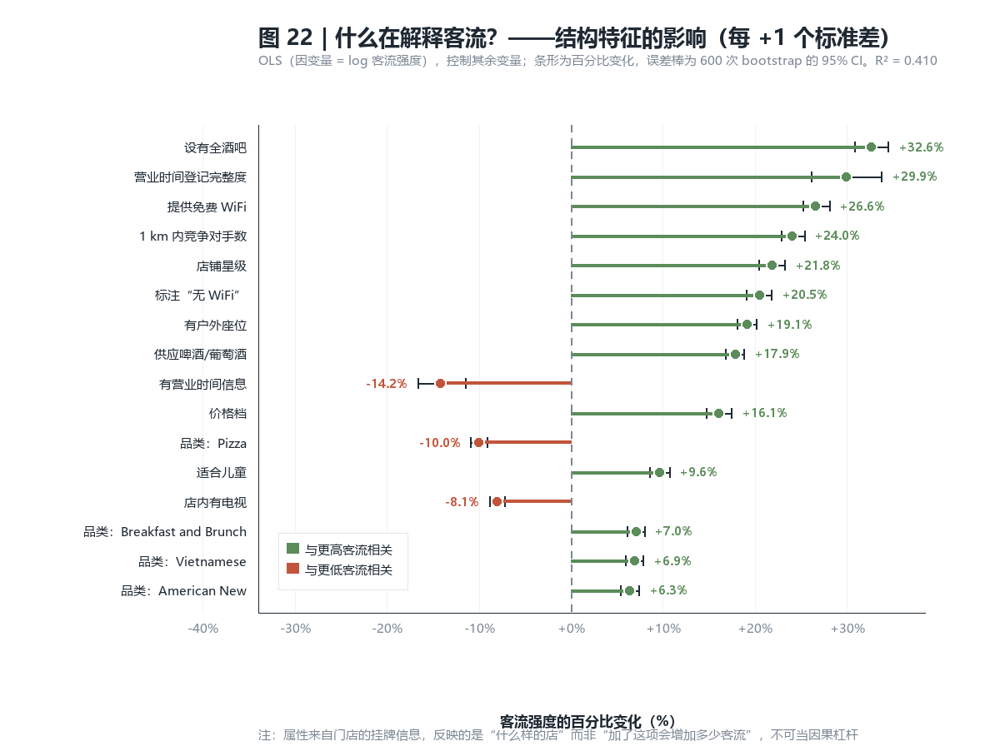
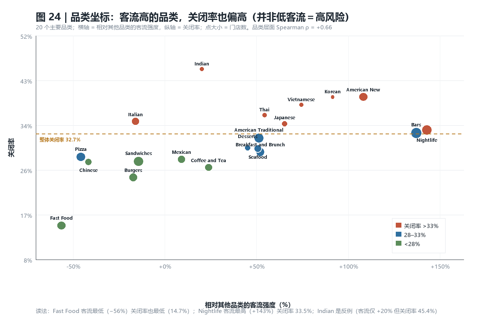
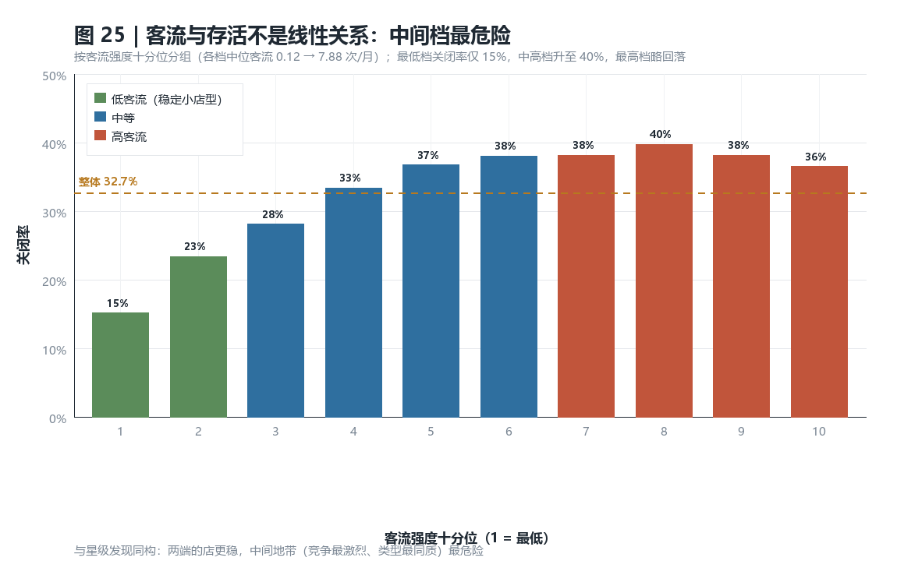

# 换一个因变量：把「客流量」作为结果变量


> 中文版 · **English edition: [FINDINGS_TRAFFIC_EN.md](FINDINGS_TRAFFIC_EN.md)**（同一份分析、同一组数字）

> 前置文档：[FINDINGS.md](FINDINGS.md)（以「是否存活」为因变量的主分析）
> 复现：`analysis/11_traffic.py` → `analysis/12_traffic_charts.py`

---

## 1. 为什么这个反转不是简单调换 Y

原分析的因变量是 `is_open`（是否存活）。改成客流后，**最大的技术风险是循环论证**：
评论量、打卡量、tips 数本身就是客流的组成部分，如果继续放在自变量位置，
就等于"用客流预测客流"。

所以本分析强制了下面这条分界线：

| 自变量（允许） | 被排除（体量类） |
|---|---|
| 挂牌属性：外送 / 外带 / 电视 / 预订 / 户外座位 / 承办宴席 / 适合儿童 / 信用卡 / 自行车停车 / 酒吧 / WiFi | `n_reviews` 评论数 |
| 价格档、营业时间完整度、营业至深夜 | `n_tips` tips 数 |
| **1 km 内竞争对手数**、城市餐厅总数 | `total_checkins` 打卡数（＝因变量分子） |
| 星级、差评占比、星级波动 | `mean_useful` 有用票、`engagement_index` |
| 品类哑变量（20 类）、活跃期中点年份（控制） | `tip_per_review`、`checkin_per_review`（比率本身由流量定义） |

**判定准则**：自变量的取值不随"来了多少客人"机械增长。
"差评占比"是构成比例（质量信号），可以留；"评论总数"是体量，必须剔。

---

## 2. 因变量定义

```
客流强度 = 打卡事件总数 ÷ 活跃月数
活跃月数 = (最后一次打卡 − 第一次打卡) / 30.44，下限 1 个月
```

- 数据源：`cleaned_checkin_expanded`，**8,515,582 条带时间戳的打卡事件**（2009-12 至 2022-01）
- 覆盖 51,318 家门店；活跃跨度中位 **68.7 个月**，88.4% 的店跨度 ≥ 365 天
- 中位 1.0 次/月，均值 2.14，最高 278 次/月 → **长尾，取对数建模**
- 建模时对 p99.5（22.8 次/月）做上限截断，避免极少数场馆主导回归

用"活跃月数"归一分母，是因为**累计打卡量随开店年限增长**：老店天然累计多，
不归一就会把"开得久"误读成"客流高"。

---

## 3. 必须先排除的两个陷阱

### 陷阱 A：打卡量的下跌是平台行为，不是客流下跌

| 年份 | 打卡量 | 有打卡的门店 | 每店均 |
|---|---:|---:|---:|
| 2013 | 951,990 | 27,744 | 34.3 |
| 2014 | 1,019,321 | 29,172 | 34.9 |
| **2015** | **1,103,125** | 30,332 | **36.4** |
| 2017 | 892,496 | 30,809 | 29.0 |
| 2019 | 692,079 | 30,620 | 22.6 |
| 2021 | 318,933 | 25,644 | 12.4 |

2015 年见顶，2021 年只剩峰值的 29%。**这是 Yelp 打卡功能的使用率下降**，
不是餐厅客流下降。因此：

- ❌ 不能用"近 12 个月打卡"衡量当前客流
- ❌ 不能把打卡量的时间趋势解读成客流趋势
- ✅ 只能用**活跃期内的平均强度**，并把活跃期中点年份放进模型做时间控制

检验：`corr(log 客流强度, 活跃期中点年份) = 0.069`，平台趋势对强度指标的污染很弱。

### 陷阱 B：中点年份与存活机械绑定

活跃期中点在 2010–2012 的店，存活率只有 **2.5%–4.6%**——因为打卡记录在门店关闭时就断了。
这与主分析里 `last_review_date` 的陷阱**完全同构**。

所以 `mid_year` **只做控制变量，绝不当预测因子**。

---

## 4. 结论

### 结论 T1｜结构因素能解释 41% 的客流差异

OLS（因变量 = log 客流强度，43 个特征）：**R² = 0.410**，n = 51,318。
横截面数据能到这个解释力，说明客流不是一个纯随机量。

**一个必须先处理的方法问题**：`corr(店铺星级, 差评占比) = −0.937`，两者近乎共线。
最初把两个都放进模型时，星级系数变成 **−5.7%**——这不是"星级越高客流越低"，
而是共线性造成的**抑制效应假象**。现已只保留星级（可解释、且与主分析可比），
并以差评占比做敏感性检验：**星级 +21.8% vs 差评占比 −20.0%**，量级一致、方向相反，
说明结论不依赖于选哪一个变量。

### 结论 T2｜密度悖论：越密集客流越高，但存活越差（核心发现）



| 十分位 | 1 km 内竞争对手 | 中位客流（次/月） | 关闭率 |
|---|---:|---:|---:|
| D1（最稀疏） | 4 | 0.49 | 23.7% |
| D5 | 30 | 0.97 | 31.0% |
| D8 | 76 | 1.53 | 37.4% |
| **D10（最密集）** | **558** | **2.47** | **45.2%** |

- 模型里 `1 km 内竞争对手数 +1 SD → 客流 +24.0%`［CI +22.8, +25.3］
- 同一维度上关闭率从 **23.7% 升到 45.2%**（约 1.9 倍）

**商业含义**：密集选址确实买得到客流（**5 倍**），但代价是关闭率接近翻倍。
所以"客流绝对值"不是好指标，**"客流 ÷ 竞争强度"才是**——
这解释了为什么很多老板觉得"店里很忙却活不下去"。

### 结论 T3｜口碑决定"来多少人"，可达性决定"能活多久"——两者互不替代



这是把因变量换成客流之后**最有解释力的一条统一叙述**：

| 变量（+1 SD） | 对**客流**的影响 | 对**存活**的影响（主分析） |
|---|---:|---|
| 店铺星级 | **+21.8%**［+20.4, +23.2］ | **≈ 0**（Spearman +0.038） |
| 差评占比（敏感性检验） | **−20.0%** | 弱 |
| 1 km 内竞争对手数 | +24.0% | 关闭率↑（D1 23.7% → D10 45.2%） |
| 是否提供外送 | **−0.5%，不显著**［−1.4, +0.5］ | **−28.6pp 关闭率**（最强因子） |
| 价格档 | +16.1% | — |

**两列几乎不重叠**，这就是关键：

> **口碑（星级/差评）显著拉高客流，但对存活几乎无影响；
> 外送可达性对客流毫无作用（甚至微负），却对存活影响最大。**

原因很直白：外送的钱**不进店门**，所以不产生打卡；
但它贡献的是一条与堂食无关的收入线，因此极大改善存活。
反过来，星级影响的是"愿意进店的人"，但进店人多并不等于能活——
租金、竞争、成本结构才是生死线。

主分析里"星级几乎不预测存活"曾经看起来反直觉，现在被这个分工解释掉了：
**星级不是没用，而是它的作用体现在客流上、不体现在存活上。**

### 结论 T4｜品类层面同样是"高客流 = 高竞争 = 高关闭"



品类层面 Spearman **ρ = +0.66**（加权 +0.665），20 个品类：

| 品类 | 相对客流 | 关闭率 |
|---|---:|---:|
| Nightlife | **+143%** | 33.5% |
| Bars | +137% | 32.9% |
| American (New) | +108% | 40.0% |
| Korean | +91% | 40.0% |
| **Fast Food** | **−56%** | **14.7%（最低）** |
| Pizza | −46% | 28.2% |
| Chinese | −42% | 27.2% |
| Burgers | −17% | 24.1% |

**注意这不等于"做快餐更安全"**：快餐的关闭率低，但单店客流也最低、
均价最低，是"低风险低回报"的另一条曲线。真正的反例是 **Indian**：
客流仅 +20%，关闭率却 45.4%——说明品类本身不是命运，竞争位置才是。

### 结论 T5｜客流与存活是倒 U 型，不是"越忙越好"



| 客流十分位 | 1 | 2 | 3 | 4 | 5 | 6 | 7 | 8 | 9 | 10 |
|---|---:|---:|---:|---:|---:|---:|---:|---:|---:|---:|
| 关闭率 | 15% | 23% | 28% | 33% | 37% | 38% | 38% | **40%** | 38% | 36% |

最低档（稳定的小店型）只有 15%，中高档峰值 40%，最高档回落到 36%。
**与星级的"中间地带最危险"完全同构**——两端的店定位清晰（要么极小的社区店，
要么真正的头部场馆），中间地带类型同质、竞争最直接。

---

## 5. 与主分析的对照

| | 主分析 | 本次 |
|---|---|---|
| 因变量 | `is_open`（是否存活） | 客流强度（次/月） |
| 最强因子 | 外送可达性（−28.6pp 关闭率） | 1 km 密度（+24.0%）、星级（+21.8%） |
| 星级的角色 | ≈ 0，**对存活无用** | **+21.8%，对客流有用** |
| 外送的角色 | **−28.6pp，对存活最强** | −0.5% 不显著，**对客流无用** |
| 模型表现 | AUC 0.763 | R² 0.410 |
| 服务对象 | 商家（是否该开外送、该选多密的地址） | 商家（该追客流还是追利润） |

**两个因变量共同给出的建议**：
1. 选址看**客流/竞争比**，不看绝对客流——密集区客流高 5 倍但关闭率高近 2 倍
2. **追存活靠可达性**（外送），**追客流靠口碑**（星级/减差评）；两者不是同一件事，
   不能指望"把评分做上去"就活得久
3. 不要用"最近生意好"当安全信号——高客流区恰恰是高风险区

---

## 6. 局限（必须随结论一起说）

1. **打卡 ≠ 真实客流**。它只是 Yelp 用户的一个主动行为，样本偏年轻、偏城市、
   偏酒吧/夜生活类；对中餐馆、社区快餐的覆盖系统性偏低。
2. **不能做时间趋势**。打卡量受平台功能生命周期主导（见陷阱 A）。
3. **非因果**。属性来自挂牌信息，"有全酒吧"是"什么样的店"的标记，
   不是"加了全酒吧就能 +31.7% 客流"的干预建议。
4. **分母由因变量自身定义**。活跃月数来自打卡首末时间，已关店的活跃期在关闭时截断；
   这对"活跃期内的强度"是合理口径，但不能解读为"开业周期"。
5. **品类差异混杂选址与客群**。品类效应无法与"这类店通常开在哪"分离。
6. **`mid_year` 只能当控制**，它与存活机械相关（陷阱 B）。
7. **属性缺失是信息**。Unknown 组客流系统性偏低，均值填充会稀释真实差异；
   已在解释中限定为"挂牌信息更完整的店客流更高"这一相关性表述。
8. **无人口口径**。1 km 邻居数是每平方公里密度，不是人均渗透率。

---

## 7. 产出文件

| 文件 | 内容 |
|---|---|
| `analysis/11_traffic.py` | 客流测度构建 + 模型 + bootstrap + 共线性与敏感性检验 |
| `analysis/12_traffic_charts.py` | 图 21–25 |
| `07_traffic_features.csv` | 51,318 行：客流测度 + 自变量 |
| `07_traffic_coefs.csv` | OLS 系数、% 效应、bootstrap CI |
| `07_traffic_poisson.csv` | Poisson（offset=活跃月数）稳健性 |
| `07_traffic_pctneg_variant.csv` | 用差评占比替换星级的敏感性检验 |
| `07_traffic_density.csv` | 密度十分位的客流/关闭率 |
| `07_traffic_category.csv` | 20 品类客流与关闭率 |

图：`charts/fig21_traffic_distribution.png` … `fig25_traffic_deciles_closure.png`
