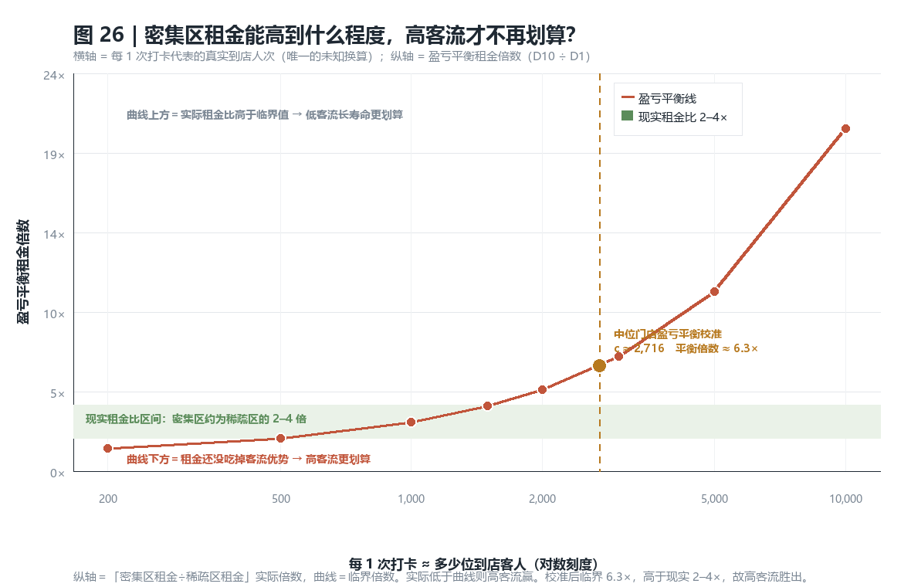
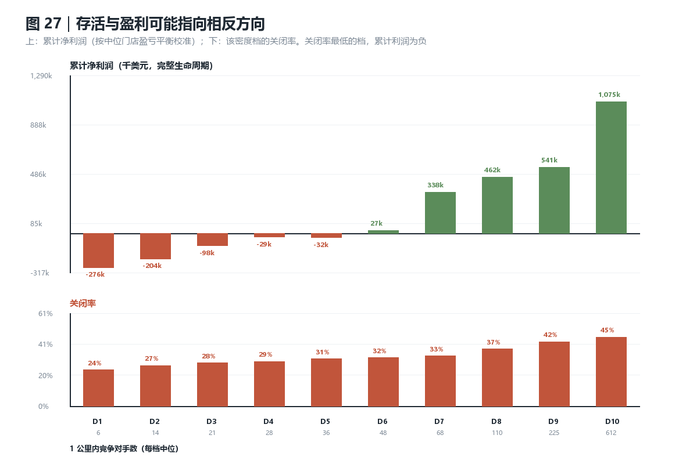
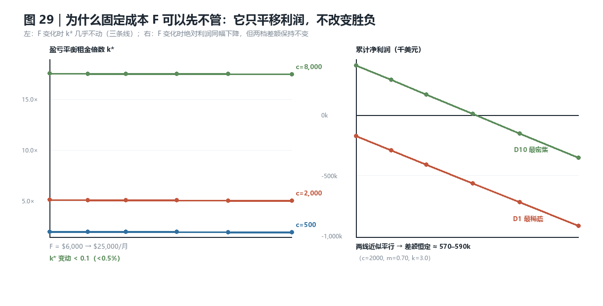
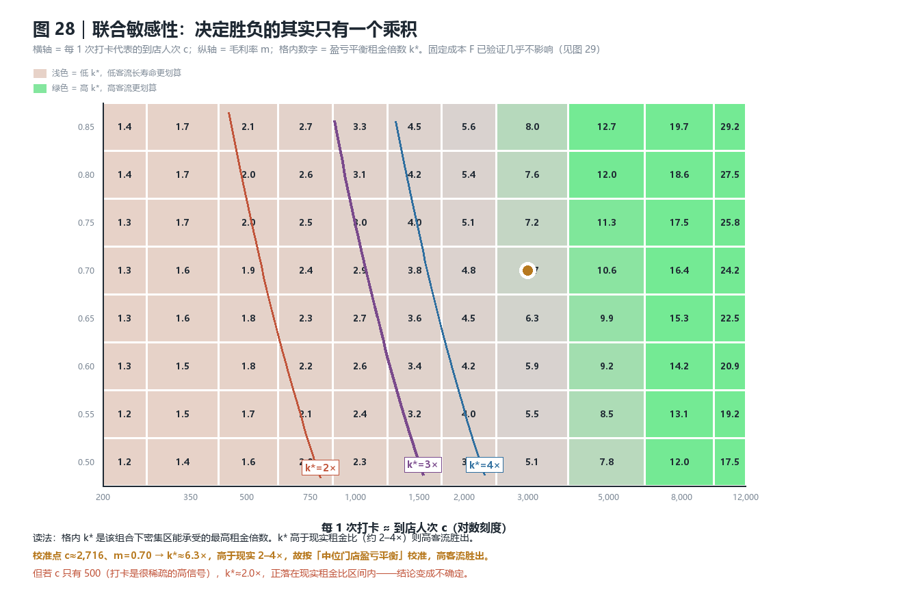

# 成功标准之争：活得长，还是累计盈利过关？

> 上游：[FINDINGS.md](FINDINGS.md)（因变量＝存活）· [FINDINGS_客流分析.md](FINDINGS_客流分析.md)（因变量＝客流）
> 复现：`analysis/13_profit_scenarios.py` → `analysis/14_profit_charts.py`

---

## 1. 问题的提出

主分析用 `is_open` 当成功标准。但这个标准本身有问题：

- **存活 ≠ 盈利**。一家店可以连续十年亏损仍在营业（靠房租长约、家庭资金、或老板不愿认输）。
- 客流与存活负相关，但这个比较混淆了两个不同的量：**短时期高客流** 与 **长时期低客流**，
  它们的累计产出不能直接比。
- 要比较，必须引入**租价、客单价、毛利率**——而这三样**数据集里完全没有**。

所以本节能做的不是"估算利润"，而是：**在明确假设下，算出两种策略的临界条件，
并指出结论依赖于哪个假设**。这是可以站住的，也是唯一诚实的做法。

---

## 2. 先修正上一节的一个错误

在客流分析里我写过"密集区寿命 0.77×"，那是**右删失造成的假象**。

用**只包含已关闭门店**（生命周期完整）重算，按密度五等分：

| 密度五分位 | 门店数 | 平均寿命 | p25 | 中位 | p75 |
|---|---:|---:|---:|---:|---:|
| 最低 | 3,553 | 43.0 月 | 15.1 | 35.5 | 65.2 |
| 第 2 | 3,260 | 44.3 | 16.8 | 36.3 | 66.7 |
| 第 3 | 3,350 | 44.3 | 16.5 | 36.0 | 66.7 |
| 第 4 | 3,276 | 43.3 | 15.7 | 34.3 | 64.9 |
| 最高 | 3,348 | 44.6 | 15.7 | 36.1 | 67.1 |

**寿命几乎完全一致**（均值 43.0–44.6 个月，中位 34.3–36.3）。

原因：用"全部门店"算中位寿命时，高密度区有更多**刚开业、还没close**的新店，
它们把中位数拉低了。这是典型的混合分布误导。

**修正后的结论**：
> 高密度区不是"死得更快"，而是**进出都更频繁**（高周转市场）。
> 单个门店的生存时长与密度几乎无关。

这一点很关键，因为它把整个比较**简化**了：既然寿命相同，
那么密集 vs 稀疏的差别**全部在客流和成本上**，不在"能活多久"上。

---

## 3. 数据能提供什么

用已关闭门店（完整生命周期）按 1 km 密度十分位：

| 十分位 | 竞争对手(中位) | 累计打卡(中位) | 寿命(月) | 客流强度＝累计÷寿命 | 价格档 |
|---|---:|---:|---:|---:|---:|
| D1 最稀疏 | 6 | 22 | 39.1 | 0.56 | 1.61 |
| D5 | 36 | 39 | 41.5 | 0.94 | 1.65 |
| D10 最密集 | 612 | **87** | 40.3 | **2.16** | 1.78 |

**D10 / D1：累计量 3.95×　寿命 1.03×　客流强度 3.86×　价格档 1.10×**

（注：客流强度这里统一用「累计量 ÷ 寿命」，以便与利润模型口径一致；
若改用"每店月均打卡的中位数"会得到 0.74→2.56，量级相同但不完全等价。）

可观测的、无需假设的结论：
> **密集区的累计客流约是稀疏区的 4 倍，而寿命基本相同。**
> 所以"高客流"的优势来自**单位时间更忙**，不来自活得更久。

---

## 4. 假设估计模型

### 4.1 公式与变量角色

对门店 $i$：

$$\pi_i = \underbrace{V_i \cdot c \cdot t_i \cdot B \cdot m}_{\text{累计毛利}} - \underbrace{M_i \cdot (R_i + F)}_{\text{累计固定成本}}$$

**本模型不含决策变量。** 它不是优化模型（没有目标函数求极值、没有约束、没有 solver），
而是一次**分组情景比较**：把 10 个密度档的观测累计量代入同一个损益式，
比较累计利润谁高谁低。下面这张表把每个符号的角色标清楚，
其中**没有一个是"决策变量"**。

| 符号 | 含义 | 角色 | 取值 / 扫描范围 |
|---|---|---|---|
| $V_i$ | 累计打卡数（＝客流强度 × 寿命） | **数据观测** | D1 22 → D10 87 |
| $M_i$ | 运营月数 | **数据观测**（有删失，见 §2） | D1 39.1 → D10 40.3 |
| $t_i$ | 平均价格档 1–4 | **数据观测** | D1 1.61 → D10 1.78 |
| $\text{dense}_i$ | 密度十分位序号 0→1 | **数据给定**（非选择） | 0, 0.111, …, 1 |
| $t_i$ 的换算 | 价格倍数 $=1+0.5(t_i-2)$ | **派生**（由观测 $t_i$ 推出） | D1 0.805× → D10 0.890× |
| $c$ | 每 1 次打卡代表的真实到店人次 | **假设**（唯一关键未知） | 扫描 200–12,000（11 档） |
| $B$ | 价格档 2 的基础客单价 | **假设** | 固定 \$15（未扫描） |
| $m$ | 毛利率（付租前） | **假设** | 扫描 0.50–0.85（8 档） |
| $F$ | 其他月固定成本 | **假设** | 扫描 \$6,000–\$25,000（6 档） |
| $R_{\text{sparse}}$ | 稀疏区（D1）月租金 | **假设** | 固定 \$8,000（未扫描） |
| $R_i$ | 月租金 $=R_{\text{sparse}}\cdot k^{\text{dense}_i}$ | **假设**（由密度派生，非自由变量） | 随 $k$ 与档位确定 |
| $k$ | 密集区相对稀疏区的租金溢价倍数 | **情景参数**（外部给定并扫描） | 扫描 1.5×–6.0×（6 档） |
| $\pi_i$ | 累计净利润 | **模型输出** | D1 −276k → D10 +1,075k |
| $k^*$ | 盈亏平衡租金倍数 | **模型输出** | 校准点 ≈ 6.3× |

**扫描规模**：$c$ 11 × $m$ 8 × $F$ 6 = **528 个组合**，再 × $k$ 6 档 = **3,168 次计算**。

### 4.2 租金不是决策变量——以及这意味着什么

租金在模型里的地位是**外生参数**，且被密度**锁死**：

$$R_i = R_{\text{sparse}} \cdot k^{\text{dense}_i}$$

一旦给定 $k$ 和档位，租金就完全确定，模型里没有任何环节去"选"租金。因此：

| 模型**能**回答 | 模型**不能**回答 |
|---|---|
| 密集区的租金溢价，值不值它带来的客流？ | 如果我在密集区把租金谈下来 20%，还值不值？ |
| 租金倍数高到多少，密集档就不再划算？ | 我应该花多少钱租哪个位置？ |

原因是**租金与客流由同一个变量（密度）驱动，二者在结构上共线**：
$\text{租金}=f(\text{密度})$、$\text{客流}=g(\text{密度})$。
这在一阶上是符合经济直觉的（买不到便宜的核心地段流量），
代价是"选址"这一个决策被拆成了两个看起来独立的量，容易被误读成两个可分别操作的杠杆。

**要让租金成为真正的决策变量，需要补三样**：
1. 真实租金数据（本数据集完全没有）；
2. 租金与密度解耦（或至少单独测量，而不是由密度推导）；
3. 一个优化框架：在"租金–客流"的联合分布下求期望累计利润最大。

那是**另一个模型**，不是本模型的参数调整。

### 4.3 一个未处理的内生性

若**经营能力更强的老板倾向于选密集地段**，则"密集 → 高客流"里就混入了**选择效应**，
不是纯地段效应；同理，租金也反映了未观测的地段质量。
因此本模型**不含任何因果结论**，只有条件性比较。

### 4.4 唯一必须外部输入的换算系数

$c$ 是整套模型里唯一真正致命的未知量。它决定了"打卡"能不能代理客流。

所以不给单一结果，而是**给一整条平衡线**：

| 每 1 次打卡 ≈ | 中位门店月营收（隐含） | **盈亏平衡租金倍数（D10÷D1）** |
|---:|---:|---:|
| 200 位客人 | $2,482 | **1.39×** |
| 500 | $6,205 | 1.98× |
| 1,000 | $12,411 | 2.97× |
| 1,500 | $18,616 | 3.95× |
| 2,000 | $24,821 | 4.93× |
| 3,000 | $37,232 | 6.90× |
| 5,000 | $62,053 | 10.84× |

### 4.5 校准选择

竞争性行业里，**中位企业应接近零经济利润**。用这个条件反解：

$$c \approx 2{,}716 \quad\Rightarrow\quad \text{隐含中位门店月营收} \approx \$33{,}900$$

（对一家小型餐厅合理。）此时**平衡租金倍数 ≈ 6.3×**。

---

## 5. 结果

**读法要小心**：纵轴是"密集区租金 ÷ 稀疏区租金"的**实际倍数**，
曲线是**临界倍数**。实际倍数**低于**曲线 → 高客流划算。

- 校准后临界值是 **6.3×**
- 现实中密集区租金通常是稀疏区的 **2–4×**
- → **实际值低于临界值，高客流策略在累计利润上胜出**

而且平衡线很陡：如果 $c$ 其实只有 500（打卡是稀疏但高信号的指标），
临界值降到 **1.98×**，正好落在现实租金比区间内，**结论变得不确定**。
结论完全取决于这个换算系数。

### 累计利润的分布

| 密度档 | 累计净利润 | 关闭率 |
|---|---:|---:|
| D1 最稀疏 | **−276k** | **24%** |
| D2 | −204k | 27% |
| D3 | −98k | 28% |
| D4 | −29k | 29% |
| D5 | −32k | 31% |
| D6 | +27k | 32% |
| D7 | +338k | 33% |
| D8 | +462k | 37% |
| D9 | +542k | 42% |
| D10 最密集 | **+1,075k** | **45%** |

**这张图就是您那个问题的核心**：

> 关闭率**最低**的 D1，累计利润是**负的**；
> 关闭率**最高**的 D10，累计利润是**最高的**。
> **存活与盈利指向相反方向。**

为什么会这样：D1 的门店活得久（39 个月），但每月只赚 0.74 单位客流，
付完租金与固定成本后每月净亏——**"活着"其实是在慢慢失血**。
D10 的店关得多，但每家店在活着的时候赚得够多，累计下来是净正。

---

## 6. 回答"活得长还是总盈利过关"

**总盈利过关才是正确标准，存活是一个有偏的代理。** 理由有三：

1. **存活把"亏损续命"也算成功。** 上表中 D1–D4 在合理假设下累计为负，
   但关闭率只有 24–29%——它们"成功地"低效存活。
2. **存活漏掉了"早死但赚够"的情况。** 高客流店可能两年就赚回全部投入然后关掉，
   在存活口径里它是失败，在盈利口径里它是成功。
3. **存活的比较受删失污染**（第 2 节那个错误就是例证）。

**但这不等于"活得长没价值"**——正确的说法是：

> 存活衡量的是**风险**（倒闭概率），
> 累计盈利衡量的是**回报**（创造多少价值）。
> 二者是不同的东西，**一家店的决策要同时看两端**，
> 而把二者压缩成一个 `is_open` 布尔值会丢失关键信息。

---

## 7. 关于"四阶段生命周期"这个提法

您的提法是对的，而且它暴露了 `is_open` 更深的问题：

**四阶段（引入／成长／成熟／衰退）里，"存活"只回答"是否还在场上"，
完全不区分处在哪个阶段。** 一家处于衰退期的店可以存活很多年，
在存活口径里它一直是"成功"，直到最后一天突然变成"失败"。

这也是上面的图能解释的：D1 那些"低关低客流"的店，
很可能有相当比例处在**衰退/僵尸状态**，而不是"稳健"。

### 数据能做但本次没做的部分

理论上可以用打卡时间序列判断门店处在哪个阶段，方法是：
1. 按年统计每家店的打卡量
2. **除以当年全平台每店均值**，消掉平台趋势（打卡量 2015 见顶、2021 只剩 29%）
3. 用归一化后的斜率判定"成长 / 平稳 / 衰退"
4. 再看不阶段的店在关闭前的行为差异

**本次没有做的原因是**：第 2 步的归一化会显著放大 2020–2021 的小样本噪声
（疫情年样本骤减），而且归一化本身会引入与世界趋势相关的伪信号。
要做得稳，需要按城市分层做同侪归一，工作量超出了本轮。
**这是明确的下一步，不是"做不了"。**

---

## 8. 联合敏感性：三个假设一起扫

一维扫描只动了 $c$。把 $c$、$m$、$F$ 一起扫，并检验一个解析猜想。

### 8.1 一个可以证明的简化：$F$ 会被抵消

密集档与稀疏档的累计利润差是

$$\Delta\Pi = c\,B\,m\,\Delta V - \big[M_{10}(R_{10}+F) - M_1(R_1+F)\big]$$

因为寿命几乎相同（$M_{10} \approx M_1 \approx M$），固定成本项变成 $F(M_{10}-M_1)\approx 0$。
**所以 $F$ 只平移两侧的绝对利润，不改变谁胜。**

数值验证（$c$ 与 $m$ 固定，$F$ 从 \$6,000 扫到 \$25,000）：

| $c$ | $m$ | $k^*(F{=}6k)$ | $k^*(F{=}12k)$ | $k^*(F{=}20k)$ | $k^*(F{=}25k)$ |
|---:|---:|---:|---:|---:|---:|
| 500 | 0.60 | 1.73 | 1.72 | 1.70 | 1.69 |
| 2,000 | 0.60 | 4.27 | 4.25 | 4.22 | 4.20 |
| 8,000 | 0.75 | 17.56 | 17.53 | 17.50 | 17.49 |

**$k^*$ 的最大变动 0.072（相对 0.4%）。** 换句话说：

> 三维敏感性在数学上退化为二维——**只有 $c \times m$ 的乘积与租金比 $k$ 决定胜负**，
> 而 $F$ 只决定"整体赚还是整体亏"。

### 8.2 真正的二维曲面

$c$ 与 $m$ 都以乘积形式进入，所以曲面呈双曲线族：**$m$ 越高，所需的 $c$ 越低**。

把"高客流胜出"翻译成对 $c \times m$ 的门槛：

| 现实租金比 $k$ | 需要的最低 $c \times m$ | 含义 |
|---:|---:|---|
| 1.5× | 208 | 极容易满足 |
| 2.0× | 389 | 容易满足 |
| 3.0× | **750** | 需 $c \approx 1{,}000$、$m=0.75$ |
| 4.0× | 1,111 | 需 $c \approx 1{,}500$、$m=0.75$ |
| 6.0× | 1,834 | 需 $c \approx 2{,}400$、$m=0.75$ |

校准点 $c=2{,}716$、$m=0.70$ → $c\times m = 1{,}901$，
高于 4× 对应的门槛 1,111，因此在这个校准下**即使密集区租金是 4 倍也仍然胜出**。

### 8.3 参数空间里到底谁赢

对每个租金比，统计 528 个 ($c$, $m$, $F$) 组合中高客流胜出的比例：

| 租金比 $k$ | 高客流胜出占比 | 中位利润差（D10−D1） |
|---:|---:|---:|
| 1.5× | 88.1% | +692k |
| 2.0× | 73.7% | +530k |
| 2.5× | 63.8% | +369k |
| 3.0× | 56.8% | +208k |
| 4.0× | **46.4%** | −114k |
| 6.0× | 33.0% | −759k |

**这张表是本节最诚实的结论**：

> 在现实租金比（2–4×）范围内，高客流胜出的概率从 **74% 降到 46%**。
> 也就是说，**结论不是"高客流一定更赚"，而是"取决于密集区到底贵多少"**。
> 只有在租金比接近 4× 时，两种策略才真正打平。

### 8.4 所以正确的说法是什么

- 若你认为打卡是稀疏信号（$c$ 大，比如 2,000+）且密集区租金不超过 3–4 倍 → **高客流累计更赚**
- 若你认为打卡很普及（$c$ 小，比如 200–500）或密集区租金超过 4 倍 → **低客流长寿命累计更赚**
- **两种说法在本数据集上都无法被证伪**，因为 $c$ 不可识别

这不是回避问题，而是把"需要什么信息才能下结论"讲清楚了：
**要有真实客流或真实营收数据，才能定论。**

---

## 9. 局限（这套估算的边界）

1. **全部货币参数都是假设。** $B$、$m$、$R$、$F$ 来自行业常识范围，不是本数据集的估计；
   只有 $V$、$M$、$t$ 是观测的。**结论是"临界条件"，不是"利润"**。
2. **$c$ 不可识别。** 数据里没有真实客流/营收，所以 $c$ 只能靠"中位门店盈亏平衡"校准，
   而那个校准本身是个假设（竞争性均衡）。平衡线已经把这个不确定性显式画出来了。
3. **打卡在不同场景的渗透率不同。** 夜生活/年轻人/城市客群打卡更频繁，
   这会让密集区的高客流**部分**是测量偏差，而非真实客流更高。
   这是本节最大的威胁：若偏差很大，4× 的累计量会被高估。
4. **只用已关闭门店**做寿命比较，会丢掉"仍然存活且很长寿"的样本；
   已用右删失论证过原因，但仍是一个选择。
5. **排除了单店方差。** 表中都是中位数/均值。D10 内部既有一年亏光的，也有十年长红的，
   决策不能只看档位均值。
6. **租金的几何递增是设定，不是观测。** 现实租金由面积、临街、楼层、合约年限决定，
   与"1 km 内竞争对手数"只是弱相关。
7. **未做敏感性到每一个参数的完整扫描。** 已做 $c$ 的一维扫描（图 26），
   但 $m$、$F$、$t_i$ 的联合敏感性未覆盖。

---

## 10. 产出

| 文件 | 内容 |
|---|---|
| `analysis/13_profit_scenarios.py` | 累计利润模型 + 校准 + 平衡倍数扫描 |
| `analysis/14_profit_charts.py` | 图 26–27 |
| `analysis/15_sensitivity.py` | $c\times m\times F$ 联合敏感性 + 解析验证 |
| `analysis/16_sensitivity_charts.py` | 图 28–29 |
| `07_profit_by_density.csv` | 各密度档的 V/M/t、累计毛利、成本、净利润 |
| `07_profit_breakeven.csv` | $c$ 与平衡租金倍数的对应关系 |
| `07_sensitivity_kstar.csv` | 各 $(c,m,F)$ 下的 $k^*$（验证 $F$ 可忽略） |
| `07_sensitivity_surface.csv` | $k^*$ 的 $c\times m$ 曲面（图 28 数据） |
| `07_sensitivity_grid.csv` | 528 个组合 × 6 个租金比的胜者与利润差 |
| `07_sensitivity_absolute.csv` | $F$ 对绝对利润水平的影响（图 29 右） |
