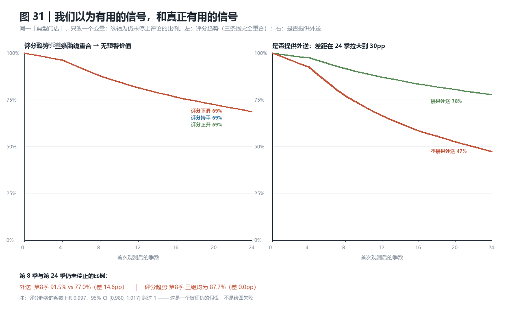
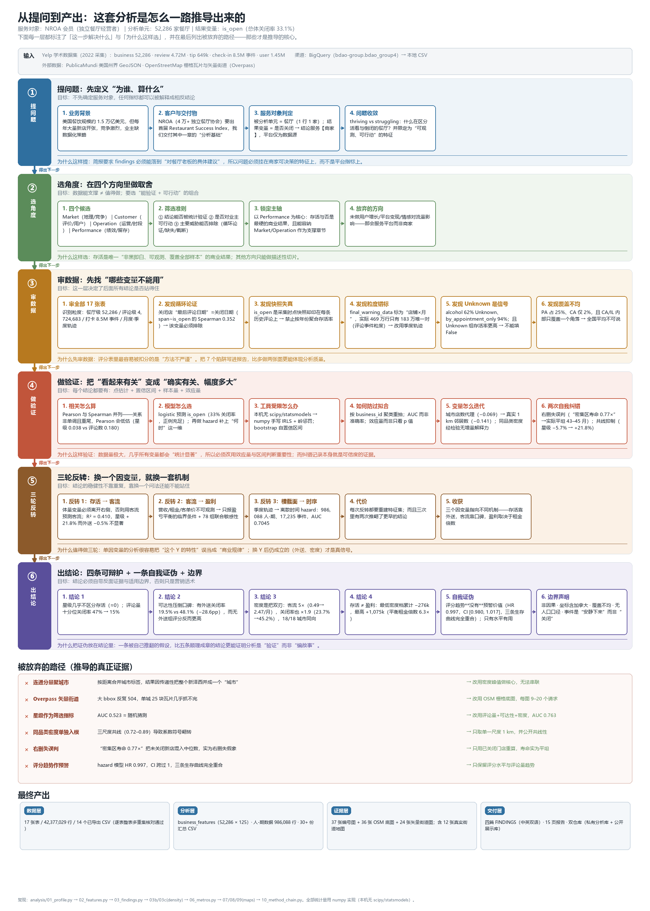
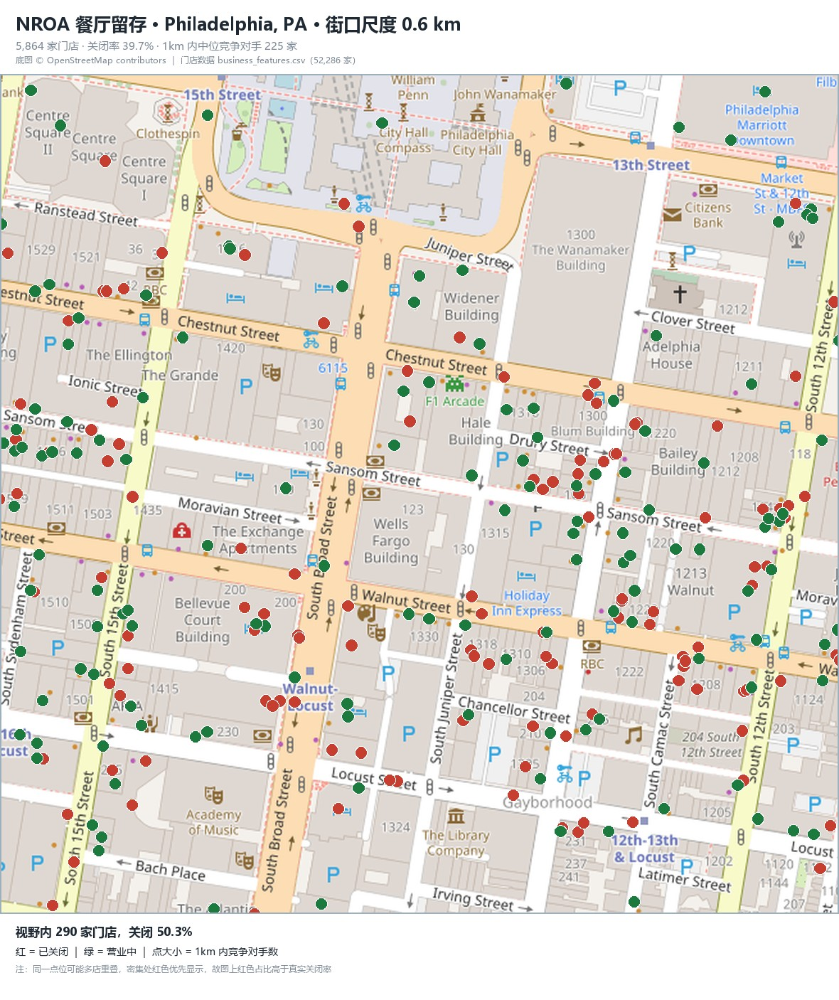

# What Keeps a Restaurant Alive — and What Makes It Profitable?

[](https://github.com/harbourzhang167-alt/yelp-restaurant-analysis/actions/workflows/checks.yml)

**A survival + traffic + profitability analysis of 52,286 US restaurants.**
Yelp academic dataset · 17 tables · 42.4 million rows · Python (no scipy/statsmodels)

<p align="center">
  
</p>

---

## The question

Restaurant owners are usually told to chase two things: better ratings, and busier
locations. This project tests both against the one outcome that cannot be argued
with — **did the restaurant survive?** — and then asks a harder question:
*is survival even the right measure of success?*

I ran the same dataset three times with three different dependent variables:

| # | Dependent variable | What it answers |
|---|---|---|
| 1 | `is_open` (survived or not) | What separates restaurants that last from ones that close? |
| 2 | Check-ins per active month | What actually brings customers through the door? |
| 3 | Modelled cumulative profit | Is a long life worth more than a busy one? |

## Four findings

**1. Reviews drive traffic; delivery drives survival — and the two barely overlap.**

| Variable (+1 SD) | Effect on traffic | Effect on survival |
|---|---:|---|
| Star rating | **+21.8%** | ≈ 0 (Spearman +0.038, sign unstable across samples) |
| 1 km competitor count | **+24.0%** | closure 23.7% → 45.2% |
| Offers delivery | **−0.5% (not significant)** | **−28.6 pp** closure rate |

Delivery money never walks through the door, so it generates no check-ins — yet it is
the single strongest survival factor in the dataset. Star ratings are the
opposite: they move traffic, but say almost nothing about whether a restaurant lasts.
The full model reaches **AUC 0.763**; ratings alone give **0.523** (a coin flip).

**2. Density buys about five times the traffic, and nearly doubles the closure rate.**

| Density decile | Median traffic/month | Closure rate |
|---|---:|---:|
| D1 (sparsest) | 0.49 | 23.7% |
| D10 (densest) | 2.47 | 45.2% |

So "how busy am I" is a bad metric. **Traffic divided by competitive intensity** is
the one that matters.

**3. Survival and profitability can point in opposite directions.**

Under an explicitly parameterised profit model, the *lowest*-density decile shows
**−$276k** cumulative profit while the *highest*-density decile shows **+$1,075k** —
even though the low-density decile has the **lowest** closure rate. Long-lived,
low-traffic restaurants can be quietly losing money for years.

**4. A sliding rating is not an early warning — we tested it and it failed.**

The two analyses above can only compare stores; they cannot say *when* anything
happens. So the quarterly trajectory table was used to build a **discrete-time hazard
model** over 986,088 store-quarters (17,235 events), with every predictor lagged and
`is_open` never used as an input.

| Variable (+1 SD) | Hazard ratio | Verdict |
|---|---:|---|
| Offers delivery | **0.606** [0.599, 0.615] | strongest protective factor |
| Review-volume trend | 0.777 [0.767, 0.790] | declining volume does predict exit |
| Recent mean rating (level) | 0.809 [0.795, 0.824] | the level matters |
| **Rating trend (direction)** | **0.997 [0.980, 1.017]** | **no effect — the hypothesis is refuted** |
| 1 km competitors (log) | 1.176 [1.158, 1.194] | density raises risk |

The rating-trend coefficient sits on top of 1, and its three survival curves overlap
exactly. **What matters is the absolute level of the rating, not whether it is
falling.** Delivery's effect also replicates here (HR 0.606), under a completely
different model, which is the strongest evidence in the repository.

<p align="center">
  
</p>

<p align="center">
  
</p>

## What this demonstrates

- **Two dependent variables, one dataset.** Reframing the target forced the whole
  feature set to change — volume variables had to leave the right-hand side.
- **Six data traps found and documented** before any modelling, e.g. a variable that
  is mechanically circular with the outcome (correlation 0.352), and a snapshot field
  repeated across historical rows that fabricates a "survival rate rising 64% → 99.7%".
- **Right-censoring corrected.** An early finding ("dense locations die younger") turned
  out to be a censoring artefact; restricted to closed stores the lifespan is flat
  across density (43–45 months).
- **A hypothesis of my own, refuted.** The report listed "rating decline" as a likely
  early-warning signal; the hazard model tested it and found HR 0.997. It is written up
  as a negative result rather than quietly dropped.
- **Everything hand-rolled.** Spearman via rank transforms, logistic regression via
  IRLS in numpy, charts drawn with Pillow — no scipy, statsmodels or matplotlib.
- **Assumptions made visible.** Where the data is silent (rent, ticket price, margin),
  the model reports a *break-even condition* plus a joint sensitivity surface rather
  than pretending to estimate profit.

<p align="center">
  
</p>

## A street-level look

The points are real per-business coordinates; the basemap is stitched OpenStreetMap.

<p align="center">
  
</p>

## How it was built

```
BigQuery export → data audit → feature engineering → survival model
                                                     → density measurement (Haversine)
                → traffic model (volume variables excluded)
                → profit scenario + joint sensitivity → figures → report
```

The 37 figures and the full write-up are in this repository. Statistical work:

| Step | Method |
|---|---|
| Correlation | Pearson **and** Spearman side by side (relationships are non-monotonic and heavy-tailed) |
| Survival model | Logistic regression, numpy IRLS with ridge; AUC via Mann-Whitney ranks |
| Uncertainty | Percentile bootstrap, 600 replicates, clustered by business |
| Spatial density | Haversine neighbour counts at 0.5 / 1 / 2 km on real GPS coordinates |
| Profit model | Parameter grid over customers-per-check-in × margin × fixed cost × rent ratio |

## Documents

Each analysis is available in **English and Chinese** — same analysis, same numbers.

| Topic | English | Chinese |
|---|---|---|
| Survival analysis (main) | [FINDINGS_EN.md](FINDINGS_EN.md) | [FINDINGS.md](FINDINGS.md) |
| Traffic as the dependent variable | [FINDINGS_TRAFFIC_EN.md](FINDINGS_TRAFFIC_EN.md) | [FINDINGS_客流分析.md](FINDINGS_客流分析.md) |
| Survival vs cumulative profit | [FINDINGS_PROFIT_EN.md](FINDINGS_PROFIT_EN.md) | [FINDINGS_盈利口径.md](FINDINGS_盈利口径.md) |
| **Timing: discrete-time hazard** | [FINDINGS_HAZARD_EN.md](FINDINGS_HAZARD_EN.md) | [FINDINGS_HAZARD.md](FINDINGS_HAZARD.md) |
| Data profiling and audit | [01_profile.md](01_profile.md) — English summary at the top | same file, full detail |
| 15-page explanatory report | — | [report-zh.docx](report-zh.docx), 11 figures |

## Team and my contribution

This was a **four-person academic group project** (BDAO, University of Auckland).

**My contribution covered three areas:**

**1. Data preparation.** Cleaned and validated the 17 exported tables, defined the
per-business analysis unit, and resolved the data-quality problems that would
otherwise have invalidated the results silently — circular variables, a snapshot
field repeated across historical rows, right-censored lifespans, and geography that
covers only a handful of states.

**2. Analytical direction.** Decided what the analysis should actually answer and in
what order: which stakeholder the findings serve, which of four candidate directions
to pursue, which dependent variable to model first, and when a result had to be
retracted. Two concrete examples: excluding `last_review_date` after showing it is
mechanically circular with closure, and correcting an early "dense locations die
younger" finding that turned out to be a right-censoring artefact rather than a real
effect.

**3. Visualisation and communication.** Designed and built all 29 figures and the
15-page report, including the OpenStreetMap basemap pipeline (tile stitching in Web
Mercator, verified against projected coordinates) and the methodology diagram that
documents the reasoning chain end to end.

The implementation was developed in an interactive, AI-assisted workflow (Python and
shell sessions). The analytical direction, the judgement calls on what to keep or
discard, and the review of each output against the underlying data were mine; the
code was scaffolded collaboratively.

## Scope and limitations

All findings are **correlational, not causal**. The strongest threat to the traffic
analysis is that check-in behaviour is itself uneven across venue types, so part of
the density effect may be measurement, not real footfall. The profit model's
monetary parameters are external assumptions, not estimates — that is stated
explicitly wherever its output appears. The dataset's geographic coverage is
concentrated in a few states, so no result here should be read as a national average.

## Data

Raw data is **not** included: it is 11.9 GB and the Yelp Data Use Agreement
prohibits redistribution. The repository contains aggregate results, figures and
the analysis code only. Per-business tables are deliberately excluded.

Map imagery © OpenStreetMap contributors, [ODbL](https://opendatacommons.org/licenses/odbl/).

## Repository checks

Three CI jobs run on every push (see [`.github/workflows/checks.yml`](.github/workflows/checks.yml)):

| Job | What it enforces |
|---|---|
| `secret-scan` | no credential material in tracked files — it matches key *signatures*, not the word "key", so the check does not flag its own source |
| `integrity` | every relative link and embedded figure resolves; no tracked file exceeds 50 MB |
| `syntax` | all analysis scripts byte-compile on Python 3.10 and 3.12 |

Both checkers also run locally:

```bash
python scripts/check_no_secrets.py
python scripts/check_links.py
```

## Licence

Code: MIT (see [LICENSE](LICENSE)).
